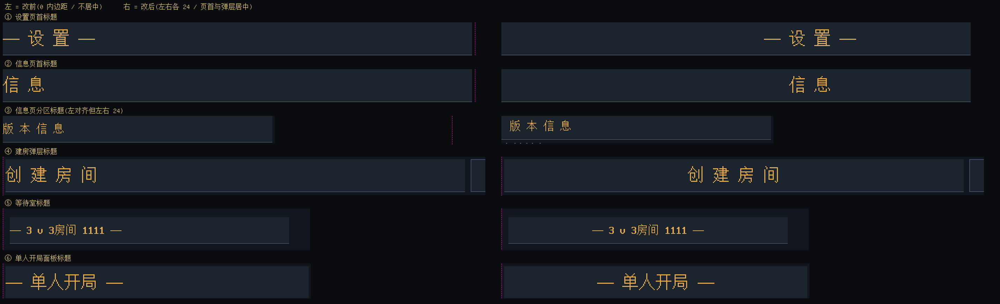
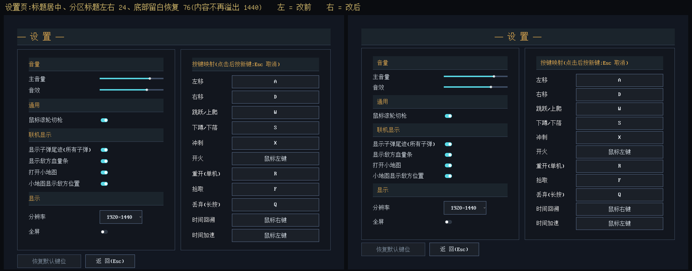
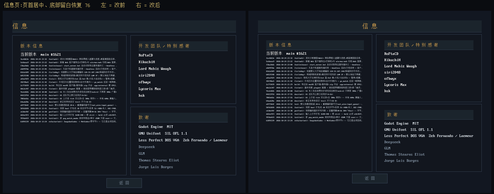
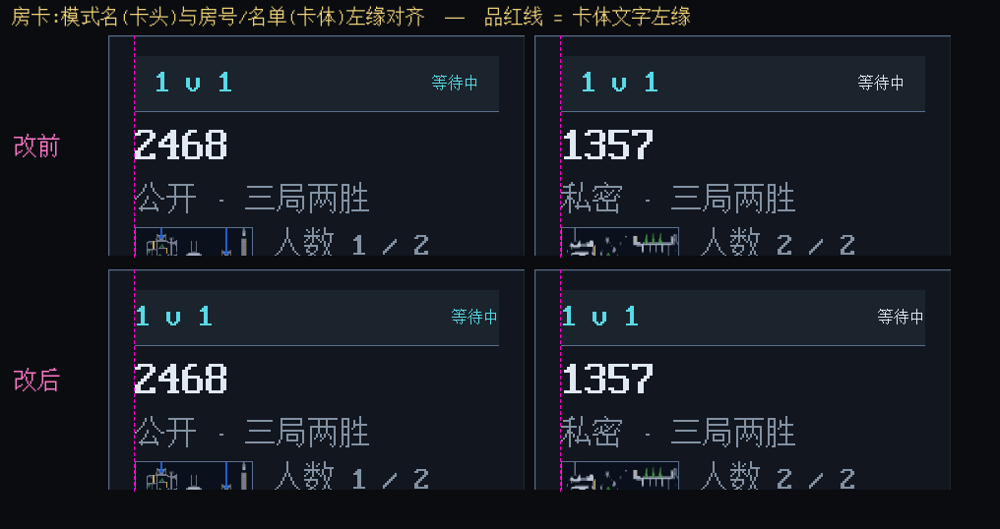

# P0：汉字顶格 / 标题不居中 / 边距修复（2026-10-27）

> 规则来源：用户在 2026-10-27 从 A/B/C/D 中选定 **A —— 页首/弹层标题居中 + 表单内分区标题左对齐，左右各 24px**。
> 改动档位：**档 1（纯表现：版式 / 间距 / 内边距）**。按 `AGENTS.md`：档 1 免变异验证与评审，判据 = 人眼对比；本轮没有新增自动守卫（标题带的镜像守卫 `menu_theme_mirror_smoke` 本来就是已删状态，见下「覆盖边界」）。
> 本文所有「改前」= `00-总览与结论.md` 那批截图（同一台机器、同一窗口模式、同一 1920×1440 逻辑分辨率）；「改后」= `shots_p0/`。

## 1. 改前 → 改后









## 2. 新的规则（唯一来源：`ui/factory/ui_factory.gd` 的 `HEADER_INSET` / `HEADER_PAD_Y`）

| 档 | 用于 | 几何 |
|---|---|---|
| `centered = true` | 页首标题、弹层标题（创建房间 / 加入房间 / 等待室 / 单人开局）、暂停菜单、结算页分区、Beta 卡片标题 | 左右内边距各 **24**，文字 `horizontal_alignment = CENTER` |
| `centered = false` | 表单内分区标题（音量 / 通用 / 联机显示 / 显示 / 按键映射 / 版本信息 / 开发团队 / 致谢 / 地图 / 禁用武器） | 左右内边距各 **24**，左对齐 |

- 旧档是「左 0 / 右 40」（`ui_factory.gd:239-240` 与主题镜像 `gen_menu_theme.gd:184-187`），15 条 `.tscn` 的 `HeaderStrip` + 4 个代码调用点全部命中，实测文字距带左缘 **0~3px**（3px 只是字形留白）。
- 新规则下实测（headless 几何 dump，`_drivers/measure_after.log`）：
  - 页首标题：设置 `752/752`、信息 `824/824`、Beta `764/764`（左/右内边距，对称 = 居中）
  - 分区标题：设置 5 条 + 信息 3 条 + 大厅 1 条全部 **左 24px**
  - 弹层标题：创建房间 `526/526`、等待室标题 `240/240`
- 房卡卡头单独一档（有意与工厂不同）：左右 **0**，让「模式名」与卡体「房号 / 地图 / 名单」左缘对齐（旧档 20 → 同卡内两条文字错开 22px）；上下保持 12。

## 3. 其他边距修复

| 项 | 改前 | 改后 |
|---|---|---|
| 设置页内容高 | 1507 > 视口 1440 ⇒ 底部按钮距屏底 9px | min 1431 ≤ 1440 ⇒ **底部留白恢复 76px**（页面 VBox 24→16、左栏 VBox 28→24、键位表行距 14→8） |
| 信息页内容高 | 1476 > 1440 ⇒ 底部留白 40px | min 1396 ≤ 1440 ⇒ **底部留白恢复 76px**（页面 VBox 24→16、右栏 VBox 24→16、名单行距 20→16；右栏两块面板加 `size_flags_vertical=3` 填补剩余高度） |
| 输入框左右内边距 | 10px（32 号字下汉字贴框） | **16px**（主题 `LineEdit` + `mp_lobby.tscn` 里 10 处手写 SubResource 同步） |

## 4. 改动文件

| 文件 | 改动 |
|---|---|
| `ui/factory/ui_factory.gd` | `header_strip()` 内边距改对称 24/20；新增 `HEADER_INSET` / `HEADER_PAD_Y`；注释换成新规则 |
| `tools/gen_menu_theme.gd` | `HeaderStrip` 变体 24/24、`LineEdit` 10→16；注释同步 |
| `ui/theme/menu_theme.tres` | **生成物**（由上一行重跑生成）：diff 只有 HeaderStrip 与两个 LineEdit 样式 |
| `scenes/settings_menu.tscn` | 页首标题居中；页面/左栏/键位表间距（见 §3） |
| `scenes/info_menu.tscn` | 页首标题居中；页面/右栏/名单间距；右栏面板 `size_flags_vertical=3` |
| `scenes/beta_menu.tscn` | 页首标题居中 |
| `scenes/mp_lobby.tscn` | 创建 / 加入 / 等待室标题居中；10 处输入框 SubResource 左右 10→16 |
| `scenes/main_menu.gd` | 「单人开局」`header_strip(..., 48, true)` |
| `scenes/beta_menu.gd` | 卡片标题 `header_strip(..., 32, true)` |
| `scenes/mp_lobby/room_list.gd` | 卡头左右内边距 20→0（对齐卡体）；注释改为「刻意与工厂不同」 |
| `docs/eng/ui.md` | 标题带规则、`LineEdit` 内边距写进「菜单语汇」条 |

## 5. 验证（照实）

- `tools/gen_menu_theme.gd` 重跑：`GEN THEME: OK`；随后 `--import` 跑过（两枚开关图标）。
- headless 几何 dump：见 §2/§3 的数字；`MarginContainer` 实测 rect 已回到 1920×1440（不再是 1507/1476）。
- headless 启动冒烟（`--quit-after 120`）：无 ERROR / SCRIPT ERROR。
- 重截 22 张受影响的屏（`shots_p0/`）与改前逐像素比对：
  - 结算页三张 **changed_px = 0**（居中分区档 padding 20→24 对已够宽的带是 no-op，确认无回归）。
  - 其余变化全部落在本次改动的元素上；主菜单 / 对局 HUD / 暂停层的 diff 来自「每局随机地图 / 主菜单背景动画 / 截图时刻」这些本来就不可复现的输入，不是版式变化（暂停层叠在随机地图上、主菜单背景每帧在动）。
- 房卡长房主名撑破卡框、大厅 IP 提示压昵称框、≥5 房卡出屏等**不在本轮范围**，仍挂在 `00-总览与结论.md`（P1/后续）。

## 6. 覆盖边界（已登记）

- ⚠️ **标题带仍有两份值**：`UiFactory.header_strip()`（代码）与主题 `HeaderStrip` 变体（`.tscn` 用）是手抄镜像，`menu_theme_mirror_smoke` 已删 ⇒ **改一处漏另一处不会红**。本次已两处同改，并把规则写进 `docs/eng/ui.md`；这是既有债，不是本次引入。
- 15 条 `.tscn` 标题带的「语义档」靠人工判断（页首/弹层 = 居中、表单内分区 = 左对齐）；没有自动检查。
- 设置 / 信息页的间距是按「1920×1440 逻辑分辨率」调的（`stretch/mode=viewport`，逻辑空间恒定，与窗口大小无关）。若将来改基准分辨率，这两页的最小高要重算。

## 7. 回滚

```bash
git restore ui/factory/ui_factory.gd tools/gen_menu_theme.gd ui/theme/menu_theme.tres \
  scenes/settings_menu.tscn scenes/info_menu.tscn scenes/beta_menu.tscn scenes/mp_lobby.tscn \
  scenes/main_menu.gd scenes/beta_menu.gd scenes/mp_lobby/room_list.gd docs/eng/ui.md
```

## 8. 复现

```
# 重生成主题 + 导入
"<GODOT>" --headless --path . -s res://tools/gen_menu_theme.gd
"<GODOT>" --headless --path . --import

# 几何量取（脚本归档在 _drivers/，跑前放回 res://audit_shots/）
"<GODOT>" --headless --path . --quit-after 3600 res://audit_shots/ui_p0_measure.tscn

# 取图（窗口模式，不要 --headless）
"<GODOT>" --path . --quit-after 3600 res://audit_shots/ui_audit_shots.tscn -- main settings info beta lobby results level broadcast
```
