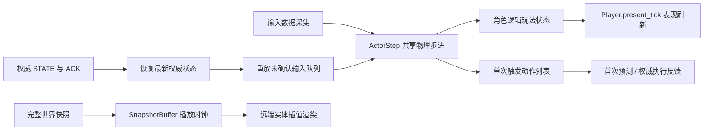

# 物理模拟、预测、表现与网络时序参考

本项目的物理模拟、客户端预测与表现层设计参考了 Teeworlds 与 Quake III 的经典网络同步架构。客户端输入按目标 tick（`target_tick`）进行调度，持续状态与单次触发动作分别通过 ACK 机制进行确认与清理；服务端广播的 STATE 采用统一的播放时钟，通过小幅度平滑调速与插值缓冲管理远端实体的渲染表现。

---

## 一、 经典网络同步设计参考与项目实现

| 参考源码与文献 | 经典架构设计思想 | 本项目落地实现 |
|---|---|---|
| [Teeworlds CCharacterCore](https://github.com/teeworlds/teeworlds/blob/master/src/game/gamecore.h) | 角色输入、物理状态、碰撞推演与产生的事件集中在共享核心步进中，与渲染组件严格解耦 | [ActorStep](../../core/sim/actor_step.gd) 为服务端、客户端预测及单人模式提供统一的物理步进；输入与捕获状态采用字典传递，步进返回动作列表 |
| [Teeworlds OnPredict](https://github.com/teeworlds/teeworlds/blob/master/src/game/client/gameclient.cpp) | 从最新权威快照恢复物理状态，逐 tick 重放本地未确认输入；预测事件随重放按新 tick 触发 | [PredictionRollback](../../core/net/prediction_rollback.gd) 恢复权威状态并重放未确认输入；重放返回的动作仅推进逻辑状态，不重复播放表现层音画 |
| [Quake III CG_PredictPlayerState](https://github.com/id-Software/Quake-III-Arena/blob/master/code/cgame/cg_predict.c) | 先完成命令重放，再处理状态转换事件；预测产生的微小位移误差在表现层平滑衰减 | [Player](../../scenes/player/player.gd) 的 `present_tick` 统一更新最终动画与 HUD；`Visuals` 节点包含角色与武器，其视觉偏移在 50ms 内平滑衰减 |
| [Quake III SV_UserMove](https://github.com/id-Software/Quake-III-Arena/blob/master/code/server/sv_client.c) | 每个输入包携带多帧冗余命令；根据序列号与时间戳跳过已执行的命令 | [InputBuffer](../../core/net/input_buffer.gd) 使用 `epoch` 与 `seq` 机制，上报 4 帧冗余输入以抗丢包；已确认的旧输入不再重复执行 |
| [Teeworlds 服务端输入调度](https://github.com/teeworlds/teeworlds/blob/master/src/engine/server/server.cpp)、[客户端时钟同步](https://github.com/teeworlds/teeworlds/blob/master/src/engine/client/client.cpp) | 输入数据包携带目标 tick；服务端反馈收包到达余量，客户端据此动态微调预测时钟 | 客户端上报输入携带 `target_tick`；服务端在 STATE 快照中反馈到达余量 `lead`，客户端据此平滑微调输入时钟 |
| [Quake III CG_ProcessSnapshots](https://github.com/id-Software/Quake-III-Arena/blob/master/code/cgame/cg_snapshot.c) | 依据插值播放时钟寻找前后快照进行平滑插值；缺少后续帧时短期外推 | [SnapshotBuffer](../../core/net/snapshot_buffer.gd) 为远端角色与掉落物维护统一的播放时钟，保留前后参考帧并限制外推时长；弹丸按出生初态本地模拟 |

---

## 二、 架构调用边界与数据流向

- **物理步进与表现解耦**：
  - `ActorStep` 基于 Godot 的 `CharacterBody2D` 原生碰撞体执行。角色的姿态碰撞、朝向计算与瞄准射线属于物理模拟；角色的骨骼动画、预瞄轨迹线、受击闪烁、HUD 界面通知、受击音效与镜头震颤属于表现层。
  - 首次预测时执行动作以产生即时开火反馈；服务端执行动作以生成权威子弹与判定伤害。预测重放期间仅推进逻辑状态，不触发动作返回值，不更新动画与界面。一轮重放完成后，统一由 `present_tick` 使用最终状态刷新表现层。
- **视觉平滑与弹道一致性**：
  - 角色物理根节点始终位于实际逻辑预测坐标。
  - 角色贴图精灵与武器节点挂载于 `Visuals` 节点，网络预测修正产生的空间位移偏差在世界坐标系下计算后转换为局部偏移，并在 50ms 内指数衰减平滑。开火原点 `shot_origin` 自动剔除该视觉偏移，确保网络预测平滑不会改变实际弹道角度。

---

## 三、 网络输入积压、乱序与丢包处理规则

| 处理环节 | 积压与乱序处理机制 | 丢包与断流应对策略 |
|---|---|---|
| **服务端输入调度** | 输入按 `target_tick` 存入队列；迟到的持续输入顺延至下一 tick 执行，当前 tick 采用最新已到达输入；移动 ACK 确认并清理旧移动记录。未来调度窗口最大 32 tick | 根据原始目标时间判断输入是否过期，最多向后延续 6 tick 的持续按键状态；随后输入归零，保持瞄准方向不变。物理、重力与武器冷却每 tick 推进一次 |
| **单次触发动作** | INPUT 独立携带未确认动作列表；按输入序号去重，每 tick 最多处理 1 条有效动作，通过 `action_ack` 独立确认并清理。目标时间后 12 tick（200ms）自动过期 | 未确认且未过期的动作随后续 INPUT 持续重复发送。超出有效期的动作予以确认并丢弃，不再补放；动作生效仍受冷却、弹药与角色状态约束 |
| **本地预测历史** | 最多保留 64 帧移动记录；从完整 STATE 的模拟 tick 开始恢复，使用统一的 `InputBuffer` 逐帧重放至当前输入时钟，单次重放上限 32 tick | 历史记录缺失或超出预算时直接对齐权威状态；控制阶段（epoch）变更时清空历史输入与动作；回溯激活期间仅推进输入时钟，自身跟随权威状态 |
| **远端快照插值播放** | 缓冲容量为 32 个 STATE 快照样本；采样保留插值左端及未来快照。播放偏差通过 0.1 权重平滑，偏差超过一个发送间隔时采用 1.02 / 0.96 倍速播放 | 播放最多推进至最新快照加 6 tick。若最新快照领先播放时钟超过 12 tick，或快照缓冲区溢出，则自动重定位快照播放时钟。断流超过 100ms 时停止外推并冻结 |
| **等待地图版本更新** | 仅保留最新一份未来版本号（`map_revision`）的远端世界；本地预测状态、ACK 确认与到达时钟反馈仍立即处理 | 等待可靠传输的地形更新事件到达并应用后，再恢复远端角色与掉落物的插值播放 |
| **底层 ENet 传输** | INPUT 与 STATE 分别分配在不同的非可靠通道上，不进行底层重传 | EVENT 通过 ENet 可靠通道重传并保持严格顺序，基线数据、READY 确认与地形事件不丢失 |

- **输入时钟动态对齐**：客户端以 `STATE tick + RTT/2 + 2 tick 余量` 初始化输入时钟。根据服务端反馈的到达余量 `lead = target_tick - server_tick`，当平滑后的 `lead` 小于 1 tick 时以 1.02 倍速微调加速，高于 3 tick 时以 0.96 倍速微调减速。此机制可在维持 60Hz 采样与物理模拟的同时，动态抵消网络延迟抖动带来的输入积压与饥饿。

---

## 四、 自动化验证与覆盖

- [输入与播放冒烟测试](../../tests/network/input_playback_smoke.gd)：覆盖目标 tick 调度、移动与动作 ACK、重复与乱序包、动作超时丢弃、连续丢包、控制阶段变更及环形边界插值连续性。
- [权威世界探针](../../tests/network/authority_probe.gd)：在真实物理场景中验证输入调度、动作去重、武器冷却、上下文保持与时钟反馈，确保重放过程静默无误。
- [客户端生命周期探针](../../tests/network/playback_lifecycle_probe.gd)：验证角色、拾取物与小地图的播放生命周期、地图版本追赶、弹丸本地飞行、榴弹爆炸动画与 Beta 弹丸恢复。
- [真实网络链路对战测试](../../tests/network/run_matches.py)：通过 `--stall` 参数在双向通信中注入 750ms 积压后的突发释放与 250ms 完全断流，验证客户端外推、冻结、重定位与最终收敛表现。实测数据见 [网络验证记录](network_validation.md)。
