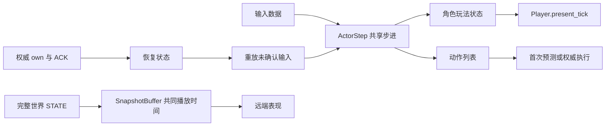

# 模拟、预测、表现与网络波动

模拟、预测与表现参考 Teeworlds 与 Quake III。输入按目标 tick 调度，持续状态和单次动作分别确认；STATE 使用共同播放时钟，缓慢调速并按播放时间管理可见实体。60 Hz 模拟、四帧冗余、六 tick 延续和 100 ms 播放缓冲是本项目参数。

## 参考与落地

| 参考源码 | 可借鉴的结构 | 本项目实现 |
|---|---|---|
| [Teeworlds CCharacterCore](https://github.com/teeworlds/teeworlds/blob/master/src/game/gamecore.h) | 角色输入、状态、碰撞推进与产生的事件放在共享核心，渲染组件独立 | [ActorStep](../../core/sim/actor_step.gd) 为服务端、预测和单人提供同一步进；输入和捕获状态是字典，步进返回动作 |
| [Teeworlds OnPredict](https://github.com/teeworlds/teeworlds/blob/master/src/game/client/gameclient.cpp) | 从快照重建核心，逐 tick 重放本地输入；预测事件按新 tick 触发 | [PredictionRollback](../../core/net/prediction_rollback.gd) 恢复权威状态、重放未确认输入；重放返回的动作不执行 |
| [Quake III CG_PredictPlayerState](https://github.com/id-Software/Quake-III-Arena/blob/master/code/cgame/cg_predict.c) | 先完成命令重放，再处理状态转换事件；预测误差在表现中衰减，传送清除误差 | [Player](../../scenes/player/player.gd) 的 present_tick 统一更新最终动画与 HUD；Visuals 包含角色与武器，独立衰减校正偏移 |
| [Quake III SV_UserMove](https://github.com/id-Software/Quake-III-Arena/blob/master/code/server/sv_client.c) | 多包携带冗余命令；通过时间标识跳过已执行命令 | [InputBuffer](../../core/net/input_buffer.gd) 使用 epoch 与 seq，四帧冗余去重；ACK 之后的迟到输入不再次执行 |
| [Teeworlds 服务端输入调度](https://github.com/teeworlds/teeworlds/blob/master/src/engine/server/server.cpp)、[客户端时钟](https://github.com/teeworlds/teeworlds/blob/master/src/engine/client/client.cpp) | 输入带目标 tick；迟到输入移至下一 tick，服务端报告到达余量，客户端调整预测时间与播放时间 | 输入携带 target_tick；STATE 回报最新输入的到达余量，客户端据此缓慢调整输入时钟 |
| [Quake III CG_ProcessSnapshots](https://github.com/id-Software/Quake-III-Arena/blob/master/code/cgame/cg_snapshot.c) | 根据播放时间寻找前后快照，越过的快照继续消费；缺少下一帧时外推 | [SnapshotBuffer](../../core/net/snapshot_buffer.gd) 给全部远端实体提供同一播放时钟，保留前后帧并限制外推 |

目标 tick、到达余量和共享步进参考 Teeworlds。独立动作列表与两个 ACK 处理跳跃、松开开火、拾取和丢弃；快照播放时钟管理远端表现，输入调度管理权威时序。

## 实际调用边界

ActorStep 使用 Godot CharacterBody2D 和原生碰撞，武器节点持有配置与玩法状态。姿态碰撞、朝向和瞄准变换属于模拟；动画、预瞄线、闪烁、HUD 通知、受击音效与镜头反馈属于表现。

首次预测执行动作以产生射击反馈；服务端执行动作以产生权威弹丸与伤害。重放只推进玩法状态，不执行返回动作，也不更新动画、预瞄线或 HUD。一次恢复和重放完成后，present_tick 使用最终状态更新表现。武器背包只有 inventory_changed 一个通知；同一轮恢复或步进中的多次变化合并到表现更新。

角色物理根节点始终位于实际预测位置。角色精灵和武器共同位于 Visuals，校正误差在世界坐标中计算，转为局部偏移后在 50 ms 内衰减；角色缩放不会放大误差。shot_origin 剔除视觉偏移，因此平滑不会改变弹道。控制阶段改变或回溯状态下直接采用权威表现位置。

客户端连接使用 LOADING、ONLINE、RECONNECTING、OFFLINE 一个 Phase；回合使用 NetEvent.RoundState 和最近一份权威回合数据。

## 积压与缺包的规则

| 位置 | 积压或乱序 | 缺包或断流 |
|---|---|---|
| 服务端输入调度 | 输入按 target_tick 留存；迟到持续状态覆盖下一 tick 的旧状态，当前 tick 选最新已到期序号，ACK 退休更旧移动。未来窗口 32 tick | 按原始目标时间判断新鲜度，最多延续六 tick 的轴与持续键；之后归零，保留瞄准。物理、重力和冷却每世界 tick 只推进一次 |
| 单次动作 | INPUT 独立携带未确认的动作；按输入序号去重，每 tick 最多处理一条有效动作，action_ack 单独退休。目标时间之后 12 tick（200 ms）过期 | 未确认且未过期时随后续 INPUT 重复发送，不依赖四条移动冗余。超期只确认、不补放；冷却、弹药、角色状态和武器实例仍决定是否生效 |
| 本地预测历史 | 最多保留 64 条移动；从完整 STATE 的模拟 tick 恢复，使用同一个 InputBuffer 逐 tick 重放到本地输入时钟，最多重放 32 tick | 历史缺失或超过预算时采用权威状态；控制 epoch 变化清空旧输入和动作；回溯期间只推进输入时钟，跟随权威自身状态 |
| 远端 STATE 播放 | 容量 32 个 STATE 样本；采样保留插值左端和未来样本。缓冲偏差以 0.1 的权重平滑，超过一个发送间隔时使用 1.02 / 0.96 倍播放速度，否则正常播放 | 播放最多到最新 tick 加六。最新状态比播放时间领先超过 12 tick，或溢出后的有效范围已经越过播放时间，才重定位到最新 tick 减六 |
| 等待地形的 STATE | 只保留最新一份未来 map_revision 的远端世界；本地状态、两个 ACK、时钟反馈和最新碰撞代理立即处理 | 等可靠地形事件追上后应用远端世界；所有远端实体继续使用同一个播放时钟 |
| 原生 ENet | INPUT 与 STATE 分别位于不同的非可靠通道；应用不为它们排可靠重发队列 | EVENT 由 ENet 可靠重传并保持顺序，基线、READY、地形事件不能随意丢弃 |

INPUT payload 为 {frames, actions}：frames 保留最新四条持续输入，actions 保留所有仍有效、尚未确认的动作。动作使用原始输入 seq、target_tick、epoch、瞄准、观察到的世界 tick、按下/松开边沿和武器实例。移动 ACK=9 不会退休仍待处理的动作 seq=1。已移除的武器动作不改为对另一把武器开火；引用相同武器不会重新装备并取消换弹。

客户端即使收不到 STATE，也在捕获输入时按模拟时间退休动作：最长存留为未来输入窗口加动作期限（44 tick）。这个上限覆盖合法的未来调度余量，避免只等 ACK 时重发列表持续增长；收到权威状态时仍按服务端 tick 的 12 tick 有效期及时退休。

客户端从 STATE tick + RTT 对应的模拟 tick + 两 tick 余量建立输入时钟；这里使用完整 RTT，是因为 STATE 已经历下行，INPUT 还将经历上行。在新 timing_seq 的到达反馈中，lead = target_tick - 收包时服务器 tick。平滑 lead 后低于一 tick 时以 1.02 倍推进、高于三 tick 时以 0.96 倍推进；重复反馈不再次参与调整。输入捕获仍为 60 Hz；时钟慢的一帧也保留单次动作，快的一帧可能推进两次本地预测，权威世界始终 60 Hz。严重停顿使输入时钟偏离 RTT 估计超过 32 tick 时重定位；到达余量偏离目标超过 12 tick 时修正时钟及未确认记录的目标时间。修正后忽略使用旧时间基准的在途反馈，直到服务端观察到新输入，避免重复修正。

两 tick 余量、六 tick 持续状态期限、12 tick 动作期限和 32 tick 未来窗口是本项目参数，不是来源项目通用推荐值。动作确认表示已消费或过期，并不保证在冷却、换弹、死亡或输入锁定状态下一定产生效果。全自动射击仍按正常冷却延续；有效窗口内的迟到短点击可触发一次尝试，缺包不伪造松开。

Godot 的 [传输模式与通道](https://docs.godotengine.org/en/stable/tutorials/networking/high_level_multiplayer.html#channels)区分非可靠、有序非可靠和可靠重发。不同通道独立维护接收顺序并共享实际带宽；可靠窗口、超时和非可靠节流由 [ENet 原生实现](https://github.com/godotengine/godot/blob/master/thirdparty/enet/protocol.c) 处理。

压力链路记录到原生 packet throttle 降到零时，INPUT/STATE 暂时停止发送。[Godot 节流接口](https://docs.godotengine.org/en/stable/classes/class_enetpacketpeer.html#class-enetpacketpeer-method-throttle-configure)说明此行为。生产使用默认参数，可靠基线与地形等待也影响播放，实测冻结时间见 [验证记录](network_validation.md)。
## STATE 样本与播放时间

容量为 32 个 STATE 样本，采样保留插值左端和未来样本。快照 tick 为 [100, 102, 104, 106]、播放 tick 为 103 时，用 102 和 104 插值，保留 [102, 104, 106]。容量溢出移除最早样本，若有效区间已越过播放时间则重定位。

100 ms 缓冲等于六个模拟 tick、三个 STATE 发送间隔。正常采样后通常只保留左端和几份未来快照；32 个连续 STATE 的首尾跨度约 1.03 秒。基线解码缓存、预测历史、命中历史和 Beta 历史各自管理生命周期。

[Quake III CG_ProcessSnapshots](https://github.com/id-Software/Quake-III-Arena/blob/master/code/cgame/cg_snapshot.c) 按播放时间推进 current/next；[Mirror SnapshotInterpolation](https://github.com/MirrorNetworking/Mirror/blob/master/Assets/Mirror/Core/SnapshotInterpolation/SnapshotInterpolation.cs) 提供缓慢调速和保留采样左端的实现参考。[Snapshot Interpolation](https://gafferongames.com/post/snapshot_interpolation/) 说明缓冲、丢包和外推误差的关系。

STATE 使用 ENet unreliable_ordered。远端外观与可见生命周期随播放样本更新，物理碰撞代理使用最新权威状态。

## 行为验证

[输入与播放探针](../../tests/network/input_playback_smoke.gd) 覆盖目标 tick、移动与动作 ACK、重复/乱序、动作过期、缺包、突发、epoch、环面、插值左端和播放时间连续性。

[权威探针](../../tests/network/authority_probe.gd) 使用真实角色验证积压调度、动作去重、冷却、武器上下文和时钟反馈，以及全部武器、Beta、AI、回合、静默重放与库存恢复。

[客户端生命周期探针](../../tests/network/playback_lifecycle_probe.gd) 覆盖角色、弹丸、拾取物、标签和小地图的可见出生/消失，最新碰撞代理、地形等待及控制阶段变化。

[真实 UDP 对战](../../tests/network/run_matches.py) 的 --stall 注入双向 750 ms 积压后的突发释放及 250 ms 断流，叠加 RTT、抖动、丢包和主动断线。客户端记录外推、冻结、重定位、样本上限与缓冲时间；结果见 [验证记录](network_validation.md)。
