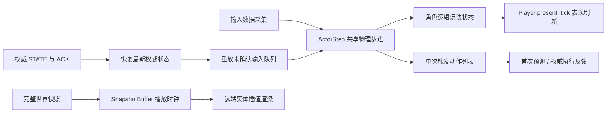

# 物理模拟、预测、表现与网络时序参考

本项目的物理模拟、客户端预测与表现层设计参考了 Teeworlds 与 Quake III 的经典网络同步架构。客户端输入按目标 tick（`target_tick`）进行调度，持续状态与单次触发动作分别通过 ACK 机制进行确认与清理；服务端广播的 STATE 采用统一的播放时钟，通过小幅度平滑调速与插值缓冲管理远端实体的渲染表现。

大型游戏公开资料对命中、伤害、死亡和运动预测范围的划分，见[命中与死亡预测调研](combat_prediction_research.md)。

LoL 的施法确认与局部预测、CS:GO / Source 的客户端重放和服务器历史命中查询，见[复杂交互与预测边界调研](lol_cs_prediction_boundaries.md)；按对象依赖缩小重放的资料见[选择性重放调研](selective_replay_research.md)。

Minecraft 基岩版的移动重放、方块与物品确认，以及 Java 26.1 的局部方块预测、角色和环境执行边界，见[Minecraft 复杂交互调研](minecraft_prediction_boundaries.md)。综合资料后的当前实现见[本地预测域设计](local_prediction_design.md)。

游戏公司的技术报告、GDC 讲义及其适用范围，见[大型游戏联机技术扩展阅读](netcode_industry_reading.md)；改造前的代码差异见[源码审计](netcode_source_audit.md)。

本轮代码改造、协议 v2 与恢复阶段见[联机重构说明](netcode_refactor.md)；八人中继对照、公网失败及尚未验证的边界见[实测记录](netcode_test_results.md)。

硬阻挡输入边界、持续输入预测与 CPU 重放成本，见[预测与性能验证](prediction_cpu_validation.md)。

---

## 一、 经典网络同步设计参考与项目实现

| 参考源码与文献 | 经典架构设计思想 | 本项目落地实现 |
|---|---|---|
| [Teeworlds CCharacterCore](https://github.com/teeworlds/teeworlds/blob/master/src/game/gamecore.h) | 角色输入、物理状态、碰撞推演与产生的事件集中在共享核心步进中，与渲染组件严格解耦 | [ActorStep](../../core/sim/actor_step.gd) 为服务端、客户端预测及单人模式提供统一的物理步进；输入与捕获状态采用字典传递，步进返回动作列表 |
| [Teeworlds OnPredict](https://github.com/teeworlds/teeworlds/blob/master/src/game/client/gameclient.cpp) | 从最新权威快照恢复物理状态，逐 tick 重放本地未确认输入；预测事件随重放按新 tick 触发 | [PredictionRollback](../../core/net/prediction_rollback.gd) 恢复权威状态并重放未确认输入；重放返回的动作仅推进逻辑状态，不重复播放表现层音画 |
| [Teeworlds 角色预测循环](https://github.com/teeworlds/teeworlds/blob/master/src/game/client/gameclient.cpp#L1430) | 从同一快照重建角色世界，按稳定编号依次计算与移动；远端未来输入使用模型预测 | 本地角色执行共享步进；远端只读运动轨迹按编号对应本地阶段与弹丸阶段，按需延伸且缓存，容量覆盖本地恢复窗口 |
| [Quake III CG_PredictPlayerState](https://github.com/id-Software/Quake-III-Arena/blob/master/code/cgame/cg_predict.c) | 先完成命令重放，再处理状态转换事件；预测产生的微小位移误差在表现层平滑衰减 | [Player](../../scenes/player/player.gd) 的 `present_tick` 统一更新最终动画与 HUD；`Visuals` 节点包含角色与武器，其视觉偏移在 50ms 内平滑衰减 |
| [Quake III SV_UserMove](https://github.com/id-Software/Quake-III-Arena/blob/master/code/server/sv_client.c) | 每个输入包携带多帧冗余命令；根据序列号与时间戳跳过已执行的命令 | [InputBuffer](../../core/net/input_buffer.gd) 使用 `epoch` 与 `seq` 机制，上报 4 帧冗余输入以抗丢包；已确认的旧输入不再重复执行 |
| [Teeworlds 服务端输入调度](https://github.com/teeworlds/teeworlds/blob/master/src/engine/server/server.cpp)、[客户端时钟同步](https://github.com/teeworlds/teeworlds/blob/master/src/engine/client/client.cpp) | 输入数据包携带目标 tick；服务端反馈收包到达余量，客户端据此动态微调预测时钟 | 客户端上报输入携带 `target_tick`；服务端在 STATE 快照中反馈到达余量 `lead`，客户端据此平滑微调输入时钟 |
| [Quake III CG_ProcessSnapshots](https://github.com/id-Software/Quake-III-Arena/blob/master/code/cgame/cg_snapshot.c) | 依据插值播放时钟寻找前后快照进行平滑插值；缺少后续帧时短期外推 | [SnapshotBuffer](../../core/net/snapshot_buffer.gd) 为远端角色与掉落物维护统一的播放时钟，保留前后参考帧并限制外推时长；弹丸按出生初态本地模拟 |
| [Quake III PM_CheckDuck](https://github.com/id-Software/Quake-III-Arena/blob/master/code/game/bg_pmove.c#L1183) | 站立和蹲伏使用逻辑碰撞箱，起身检查净空 | Player 共用站立、蹲伏两个矩形，宽度与脚底一致；动画使用独立姿态 |
| [DDNet 预输入转发](https://github.com/ddnet/ddnet/blob/master/src/engine/server/server.cpp#L1833)、[Unity 输入预测](https://docs.unity.cn/Packages/com.unity.netcode%401.5/manual/intro-to-prediction.html) | 按预定 tick 保存输入，从权威世界复制预测世界；未知未来帧延续最后输入 | RoomSession 仍保留有界输入提示协议；当前客户端不以远端提示驱动重放。只重建本地 ACK 后的命令，并复核远端运动代理是否改变实际查询结果 |
| [Unity 预测实体交互](https://docs.unity.cn/Packages/com.unity.netcode@1.3/manual/prediction-details.html) | 相互作用的预测实体需要处于一致的回滚时间线 | 本地恢复使用一致地图版本；远端代理读取明确阶段的有界估计，几何查询变化使本地后缀失效，不宣称等同于整体确定性预测 |
| [Unity 预测生成与回滚](https://docs.unity.cn/Packages/com.unity.netcode%401.5/manual/ghost-spawning.html) | 预测生成与服务端采用相同条件，按出生 tick 恢复实体，匹配或撤销预测生成 | 开火上限读取模拟弹丸数量，弹药与后坐力随角色还原；可靠结束 tick 限定弹丸的重放生命周期 |
| [Celeste / TowerFall 碰撞模型](https://www.maddymakesgames.com/articles/celeste_and_towerfall_physics/index.html)、[Godot 运动查询](https://docs.godotengine.org/en/stable/classes/class_physicsbody2d.html#class-physicsbody2d-method-move-and-collide) | 矩形角色按轴处理运动和阻挡 | ActorStep 将移动与击退速度合为一次 X/Y 位移；地形使用 Godot 查询，ActorCollider 计算角色间矩形阻挡 |
| [Epic 移动同步](https://dev.epicgames.com/documentation/en-us/unreal-engine/understanding-networked-movement-in-the-character-movement-component-for-unreal-engine)、[移动能力设计](https://dev.epicgames.com/community/learning/tutorials/ywD1/unreal-engine-best-practices-for-networked-movement-abilities) | 冲量、力与重力纳入移动状态和重放；处理输入前先应用权威修正 | NetBus 在物理 tick 开始时接收消息，随后恢复并预测。远端阻挡状态包含独立击退及逐 tick 衰减；角色按稳定 ID 顺序对应接触时刻 |
| [Epic Gameplay Ability Prediction](https://dev.epicgames.com/documentation/unreal-engine/API/Plugins/GameplayAbilities/FPredictionKey)、[Quake III 预测状态](https://github.com/id-Software/Quake-III-Arena/blob/master/code/cgame/cg_predict.c) | 预测需要覆盖相关副作用，并在确认后处理恢复、覆盖与重复执行；生命值和死亡模式参与运动状态 | 已知攻击预测本地 HP、倒地碰撞及冲量，确认结果按 tick 覆盖；远端伤害由权威状态播放，表现事件由独立入口播放 |
| [Epic SavedMove](https://dev.epicgames.com/documentation/unreal-engine/API/Runtime/Engine/FSavedMove_Character)、[Godot 角色移动源码](https://github.com/godotengine/godot/blob/master/scene/2d/physics/character_body_2d.cpp) | 移动恢复包含接地上下文，碰撞查询具有明确的时间和位姿 | ActorStep 保存自己的接地、计时器、攀爬、蹲伏与击退状态；还原后立即查询位姿，按本 tick 的轴向接触更新接地 |

---

## 二、 架构调用边界与数据流向

- **物理步进与表现解耦**：
  - `ActorStep` 使用 CharacterBody2D 查询地形，ActorCollider 计算角色阻挡。逻辑碰撞箱、速度、朝向和瞄准方向属于模拟状态；动画、预瞄轨迹线、受击闪烁、HUD、音效和镜头震颤由表现层读取最终状态。
  - 首次预测时执行动作以产生即时开火反馈；服务端执行动作以生成权威子弹与判定伤害。预测重放期间仅推进逻辑状态，不触发动作返回值，不更新动画与界面。一轮重放完成后，统一由 `present_tick` 使用最终状态刷新表现层。
- **视觉平滑与弹道一致性**：
  - 角色物理根节点始终位于实际逻辑预测坐标。
  - 角色贴图精灵与武器节点挂载于 `Visuals` 节点，网络预测修正产生的空间位移偏差在世界坐标系下计算后转换为局部偏移，并在 50ms 内线性衰减平滑。开火原点 `shot_origin` 自动剔除该视觉偏移，确保网络预测平滑不会改变实际弹道角度。

---

## 三、 网络输入积压、乱序与丢包处理规则

| 处理环节 | 积压与乱序处理机制 | 丢包与断流应对策略 |
|---|---|---|
| **服务端输入调度** | 输入按 `target_tick` 存入队列；迟到的持续输入顺延至下一 tick 执行，当前 tick 采用最新已到达输入；移动 ACK 确认并清理旧移动记录。未来调度窗口最大 32 tick | 根据原始目标时间判断输入是否过期，最多向后延续 6 tick 的持续按键状态；随后输入归零，保持瞄准方向不变。物理、重力与武器冷却每 tick 推进一次 |
| **单次触发动作** | INPUT 独立携带未确认动作列表；按输入序号去重，每 tick 最多处理 1 条有效动作，通过 `action_ack` 独立确认并清理。目标时间后 12 tick（200ms）自动过期 | 未确认且未过期的动作随后续 INPUT 持续重复发送。超出有效期的动作予以确认并丢弃，不再补放；动作生效仍受冷却、弹药与角色状态约束 |
| **本地预测历史** | 最多保留 64 帧移动记录；从完整 STATE 的模拟 tick 开始恢复，使用统一的 `InputBuffer` 逐帧重放至当前输入时钟。预测时钟、模拟与输入目标最多领先最新权威 tick 32 tick | 达到窗口边界后冻结预测位置，继续发送输入；动作按输入序号保留有限窗口。历史缺失时直接对齐权威状态；控制阶段（epoch）变更时清空历史与动作；回溯激活期间自身跟随权威状态 |
| **远端快照插值播放** | 缓冲容量为 32 个 STATE 快照样本；采样保留插值左端及未来快照。播放偏差通过 0.1 权重平滑，偏差超过一个发送间隔时采用 1.02 / 0.96 倍速播放 | 播放最多推进至最新快照加 6 tick。若最新快照领先播放时钟超过 12 tick，或快照缓冲区溢出，则自动重定位快照播放时钟。断流超过 100ms 时停止外推并冻结 |
| **等待地图版本更新** | 保留最新一份未来版本号（`map_revision`）的完整 STATE；地形和本地对账在物理帧统一应用 | 可靠地形事件到达并提交碰撞后，应用版本一致的自身状态和远端世界；当前地形之前的 STATE 不进入重放 |
| **底层 GNS 传输** | INPUT 与 STATE 分别使用独立的非可靠 lane；每条 lane 仅保留最新待发消息 | EVENT 使用可靠有序 lane，完整组装后派发；三条 lane 同优先级、同权重 |

- **输入时钟动态对齐**：客户端以 `STATE tick + min(ceil(RTT_ms × 60 / 1000) + 2, 32)` 初始化输入时钟，覆盖快照下行和输入上行时间。新序号的到达余量 `lead = target_tick - server_tick` 以 0.1 权重更新平滑值；小于 1 tick 时以 1.02 倍速推进，高于 3 tick 时以 0.96 倍速推进。输入的目标 tick 写入后保持不变。时钟越出可恢复窗口时从新权威状态重建。

---

## 四、 自动化验证与覆盖

所有武器的命中由 [CombatPrediction](../../core/net/combat_prediction.gd) 放入角色模拟时间线，共用 `CombatComponent.simulate_hit` 更新 HP、击退和倒地状态，再由 `ActorStep` 推进运动。普通弹丸共用连续检测，激光共用光束路径相交判定，爆炸共用范围、掩体和水体计算；命中按稳定攻击 ID 与绝对 tick 确认。参考 [DDNet 的预测弹丸](https://github.com/ddnet/ddnet/blob/master/src/game/client/prediction/entities/projectile.cpp)、[预测光束](https://github.com/ddnet/ddnet/blob/master/src/game/client/prediction/entities/laser.cpp)和[预测世界爆炸](https://github.com/ddnet/ddnet/blob/master/src/game/client/prediction/gameworld.cpp)。当前实现与实测见 [完整受击预测验证](combat_outcome_validation.md)。

手动模拟的位姿更新使用 [PhysicsServer2D 的静态模式](https://docs.godotengine.org/en/stable/classes/class_physicsserver2d.html#enum-physicsserver2d-bodymode)和显式运动查询。Godot 的 [原生位姿实现](https://github.com/godotengine/godot/blob/master/modules/godot_physics_2d/godot_body_2d.cpp)区分即时设置的静态位姿与在物理步提交的运动学位姿；[问题 76256](https://github.com/godotengine/godot/issues/76256)记录了运动学体同帧变换查询的限制。`ActorStep` 在每个手动 tick 提交位姿，再调用 Godot 的运动查询。

生命周期使用绝对模拟 tick 安排复活；[Teeworlds 的服务端玩家调度](https://github.com/teeworlds/teeworlds/blob/master/src/game/server/player.cpp)也使用 `m_RespawnTick`。本项目将复活 tick 同步给角色阻挡预测；移动状态所依赖的数据随 STATE 同步，遵循 [State Synchronization](https://gafferongames.com/post/state_synchronization/) 对外推状态完整性的要求。

- [输入与播放冒烟测试](../../tests/network/input_playback_smoke.gd)：覆盖目标 tick 调度、移动与动作 ACK、重复与乱序包、动作超时丢弃、连续丢包、控制阶段变更及环形边界插值连续性。
- [权威世界探针](../../tests/network/authority_probe.gd)：在真实物理场景中验证输入调度、动作去重、武器冷却、上下文保持与时钟反馈，确保重放过程静默无误。
- [客户端生命周期探针](../../tests/network/playback_lifecycle_probe.gd)：验证角色、拾取物与小地图的播放生命周期、地图版本追赶、弹丸本地飞行、榴弹爆炸动画与 Beta 弹丸恢复。
- [真实网络链路对战测试](../../tests/network/run_matches.py)：通过 `--stall` 参数在双向通信中注入 750ms 积压后的突发释放与 250ms 完全断流，验证客户端外推、冻结、重定位与最终收敛表现。实测数据见 [GNS 验证记录](gns_validation.md)。
