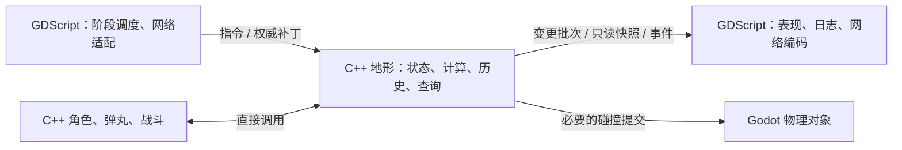

# 原生地形的指令、计算与输出边界调研

2026-10-28 实施前调研快照。下文记录当时的结构与建议；后续实现及验证见[迁移记录](native_terrain_migration.md)。校正问题不在本轮范围。

## 判断

建议将运行时地形的状态、规则计算、变化历史、查询与碰撞布局统一迁入 C++，GDScript 通过领域指令操作它，再消费变更结果、事件与只读快照。这与当前场景内原生模拟方案一致，能够继续使用 Godot 的节点、资源和物理引擎。

关键是地形状态只有一个写入者，同时让原生角色、弹丸和战斗直接访问原生地形。单独把循环改写成 C++、仍由脚本传入全部可变容器，不能完成这个边界。

“指令”首先可以是类型明确的同步方法调用，例如 `damage_blast(...)`、`apply_authority(...)`、`restore_checkpoint(...)`。批量操作使用批次接口；不要求额外建立异步消息队列，也不自动引入一个新的地形调度线程。

## 一手资料及其支持范围

| 资料 | 实际设计或说明 | 对本项目的启示 |
|---|---|---|
| [Godot：Optimization using Servers](https://docs.godotengine.org/en/stable/tutorials/performance/using_servers.html) | 场景系统建立在底层 Server API 上；可使用场景中的物理空间和底层 API；直接使用 RID 时需要处理其生命周期 | 原生数据核心可以与 Godot 场景、物理共存；是否进一步使用 RID 是独立选择 |
| [Godot：CPU optimization](https://docs.godotengine.org/en/stable/tutorials/performance/cpu_optimization.html) | 节点有管理成本；C++ 是性能实现选项；性能判断需要测量 | 原生迁移有合理基础，但不能仅凭语言选择承诺整帧收益 |
| [Voxel Tools：项目](https://github.com/Zylann/godot_voxel)、[VoxelTool API](https://voxel-tools.readthedocs.io/en/latest/api/VoxelTool/) | Godot 的 C++ 地形模块/扩展，脚本使用挖球、盒形编辑、复制粘贴和射线等操作 | 这是与“脚本发出地形操作、原生系统持有数据和执行计算”很接近的实例 |
| [Voxel Tools：Performance](https://voxel-tools.readthedocs.io/en/latest/performance/#editing-voxels-efficiently) | 逐体素 API 会重复查找、坐标转换、锁和通知；批量区域操作可复用这些工作；并发存储还会引入锁与复制成本 | 应迁移整个区域操作及状态归属，避免脚本逐格调用；线程数不是越多越好 |
| [Box2D：Events](https://box2d.org/documentation/group__events.html) | 模拟过程中收集事件，步进后提供事件数组；直接在模拟回调中修改世界存在问题 | 原生层输出事件批次，外层在明确边界消费，避免逐子格同步回调与重入 |
| [Unity Entities：Use an entity command buffer](https://docs.unity3d.com/Packages/com.unity.entities@1.0/manual/systems-entity-command-buffer-use.html) | 记录指令与执行指令分离，集中执行可减少结构变化的同步点；文档同时指出某些立即批量操作比指令缓冲更快 | 借鉴明确的执行点和批量处理，不把“加队列”本身视为优化 |
| [Photon Quantum：Events & Callbacks](https://doc.photonengine.com/quantum/v3/manual/quantum-ecs/game-events) | 连续表现读取状态，一次性效果消费事件；表现事件不修改模拟状态；预测事件需要去重、确认或取消 | 地形画面根据最终状态更新，重放不重复播放破坏效果；玩法反馈走模拟内的顺序 |
| [Godot：Thread-safe APIs](https://docs.godotengine.org/en/stable/tutorials/performance/thread_safe_apis.html) | 活跃场景树交互不是线程安全的，物理 Server 的线程安全还涉及设置 | 首先维持主线程同步执行，之后再按独立任务决定是否并行 |

上述资料支持这些边界和处理方式，没有证明本项目迁移后的具体加速比例。下文类名与接口为本项目建议。

## 迁移前的职责分散

| 当前位置 | 仍然持有或执行的地形职责 |
|---|---|
| [TileDefs](../../core/sim/tile_defs.gd) | 全局可变 `sub_hp`、格级 HP、材质表、受损/破坏回调和版本；直接修改 `MazeGenerator.current_grid` |
| [原生地形（替代旧模块）](../../native/simulation/terrain.cpp) | 权威基线、预测修改、恢复与确认、脏区域、爆炸核缓存；以 Dictionary/Array 保存历史并重建指定 tick 的值 |
| [原生地形（替代旧模块）](../../native/simulation/terrain.cpp) | 单人回溯的改前值、时间区间查询和历史裁剪 |
| [Level0](../../scenes/level_0.gd) | 原始地图、可破坏碰撞网格、脏块、渲染脏格、恢复和提交；根据回调配置选择原生批量路径或脚本逐格路径 |
| [CollisionBuilder](../../core/sim/collision_builder.gd) | 几何变化版本及区域历史、初始化和脚本分块构建、形状复用 |
| [AuthorityWorld](../../server/authority_world.gd) | 收集权威 HP 增量、更新地图版本、维护服务端碰撞脏块、结算破坏收益 |
| [原生地形（替代旧模块）](../../native/simulation/terrain.cpp) | 接收外部 Godot 容器的批量函数；原生伤害应用、补丁和矩形布局；布局/形状缓存仍有部分保存在节点 metadata 中 |
| [NativeMotionGeometry](../../native/simulation/simulation.cpp) | 算法在 C++，运行时仍借用脚本的嵌套网格；调用方重复传入 HP 和几何版本 |

这里的重点是所有权和职责分散。当前已经有局部更新、布局缓存、形状复用和变化区域失效，不应为了“完全迁移”丢掉这些现有优化。

### 已确认的往返与复制路径

1. `CombatPrediction.step()` 调用 `NativeCombatKernel.continue_step()`，原生段遇到爆炸后返回；脚本发出 `terrain_blast`，经 `PvpMatchClient._predict_blast_terrain()` 到 `PredictionTerrain.predict()`，生成首次爆炸核，调用 `NativeTerrainOps.predict()`，再经 Level0 调用原生 `apply_patch()`。它保持了顺序，但一轮原生战斗仍需要脚本反复接力。
2. `NativeTerrainOps::apply_patch()` 按值接收 `PackedInt32Array hp`，调用 `hp.ptrw()`，随后把数组返回给 `TileDefs.sub_hp`。在调用方仍持有原数组的情况下，这存在整份 HP 缓冲区的写时复制路径，补丁只改少数子格也不等于只复制少数子格。[本机引擎对应版本的 CowData](https://github.com/godotengine/godot/blob/a13da4feb/core/templates/cowdata.h)中，`ptrw()` 会确保缓冲独占，发生分离时复制原缓冲。本轮没有计量这部分耗时。
3. `NativeMotionGeometry::configure()` 保存 Godot Array 网格；`value()` 仍通过行 Array 读取 Variant。它避免了回调脚本，但尚不是由原生地形直接提供连续数据的查询。
4. `Level0.apply_prediction_terrain()` 需要判断回调是否匹配来选择快路径。服务端、单人和预测的地形写入存在不同接力路径；每次修改都需要考虑多处状态及通知是否一致。

## 建议的最终职责

### C++ 持有并计算

- 原始材质/纹理、当前子格 HP、宏观格存亡与碰撞占用；按连续原生数组保存，更新时不再往返传入整份可变 HP。JSON 配置仍是统一来源，加载时转换一次。
- 子格和爆炸伤害、材质可破坏规则、环面坐标、射线/遮挡、水体与攀爬查询。C++ 角色与弹丸直接读取这些数据；不先向脚本导出快照再转交给原生运动。
- 地形预测历史、权威合并、恢复、确认、局部变化依赖和有界历史裁剪。单人时间回溯与网络预测恢复保留各自时间轴及规则，共用底层写入和改前值记录。
- 脏块、布局签名、矩形分解、布局/形状复用、碰撞版本及影响区域。当前几何未改变时不提交、远处变化不使无关轨迹失效等行为继续保留。
- 生成权威地形增量、表现变化和破坏事实；由外层按职责消费。地形不直接发送网络包、播放音效或操作账户 UI。

建议使用一个对外的原生地形对象，内部保持数据核心与 Godot 物理适配的分工。可以用原生节点承载并拥有碰撞子节点，让 Godot 继续管理生命周期。初期沿用现有 StaticBody2D/CollisionShape2D，直接 RID 管理另行评估；这样不会为了迁移同时重写一套场景生命周期。

### GDScript 负责适配与使用结果

加载地图文件和配置、提供网络权威补丁、调用地形恢复/重置、安排现有 tick 和阶段边界，消费原生导出的增量进行显示、日志和网络编码。地形数据的修改只能通过原生指令入口，兼容接口可转发，不能再维护一套可独立写入的 `sub_hp/current_grid`。

地形视图仍可使用 Godot 的 TileMapLayer、图集和材质。若批量瓦片提交本身也需要迁移，可让原生视图适配器一次接收整批变化；GDScript 不负责重新计算子格存亡或碰撞布局。

## 指令和输出应是什么粒度

| 操作 | 输入 | 原生层负责的结果 |
|---|---|---|
| 加载 / 重置 | 地图数据、材质表、地图代次 | 初始化状态、索引和碰撞，发布基线 |
| 爆炸 / 区域伤害 | tick、阶段、稳定来源 ID、位置、配置 ID、owner role | 扫描影响区域、计算伤害、修改 HP、记录历史、生成脏区和破坏事实 |
| 应用权威补丁 | tick、权威版本、改变的子格与 HP | 合并权威与未确认预测、审核差异并保持版本语义 |
| 恢复 / 确认 | 检查点句柄或 tick | 恢复必要变化、维护历史边界、使后续查询看到正确地形 |
| 查询 | 原生查询参数，或脚本的批量查询请求 | 返回结果和依赖信息，不暴露内部可写容器 |

批量调用覆盖一个实际领域操作，例如“一次爆炸”，而不是脚本循环调用每个子格的 `set_hp()`。如果来源已经在原生战斗核内，就直接调用原生地形；不要求绕回 GDScript 发同一条指令。

对外主要输出三类数据：

1. **地形增量**：改变的子格/分块、最终值、地图代次与版本。常规显示和网络消费增量；完整地图快照只在基线、重连、保存或显式检查时导出。
2. **有界检查点**：原生内部通过改前/改后记录和必要的检查点恢复，避免每 tick 把整张地图复制到 GDScript。最初可以沿用稀疏变化历史，无需同时引入复杂持久化树。
3. **事实事件批次**：受损、破坏、来源和奖励依据，保留稳定身份及 tick/阶段。快照本身不可作为地形内部数组的共享写入口，跨历史保存的数据不含场景指针或物理 RID。

## 必须保留的时序

当前代码已经有明确要求：`NativeCombatKernel.continue_step()` 在爆炸后暂停，注释指出外层要在下一次攻击前提交地形；`CombatPrediction.step()` 则按攻击顺序接力处理。迁移后应由 C++ 战斗直接调用 C++ 地形并完成必要提交，再继续下一次攻击。不能把这些操作都推迟到显示帧末尾。

- 地形写入按原来的 tick、阶段和攻击顺序执行。同一阶段后续查询必须看到之前操作产生的变化。指令批量化不能随意重排造成破坏和收益归属变化。
- 查询需要的碰撞更新在对应模拟边界完成；相同分块可以合并无中间读取的连续写入，但存在中间依赖查询时必须保留可见性。
- 服务端的“破坏地形获得颗粒”会影响后续玩法。它属于模拟结果，必须在原阶段完成应用，或者通过同步返回的结果批次在继续模拟前结算，不能等待表现事件。
- 瓦片画面、碎片和音效在本轮恢复、重放和推进完成后处理。画面按最终增量更新；同一预测事件重放时去重，必要时支持确认/取消。

账户结算当前仍在 `TimeEconomy` 脚本中。地形迁移可以移除地形计算的脚本接力；如果进一步要求整个战斗阶段完全不返回脚本，还需要原生化对应的模拟结果消费者。这是后续边界，不能通过把收益通知延迟到表现阶段来省略。

因此，**计算中的同步依赖与计算后的表现通知分别处理**。事件输出不等于所有工作都异步执行，也不等于每个子格立即发一次 Godot signal。

## 存储、版本与线程选择

当前权威 `map_revision`、预测历史代次和碰撞 `geometry_revision` 含义不同。迁移时统一由原生层管理相关状态，但保留这些不同语义：HP 变化、占用变化、地图切换和历史恢复不是同一种变化。恢复旧状态也不能让新发布的变更身份与旧任务混淆。网络修订号的递增规则应保持兼容，不能仅为了批量化把原有逐修改语义悄悄改成逐批次语义。

建议首先使用主线程单写者、同步指令和连续存储。这样地形操作无需为自身状态加跨线程锁。之后若确有独立且昂贵的布局生成任务，可对不可变输入并行计算，在主线程按地图代次/版本验证后提交。不能把过期任务的几何重新装回新地形，也不能让影响下一次物理查询的碰撞结果无限延后。

原生容器用于热点状态；Godot 容器保留在加载、网络和表现边界。快照按改变的区域导出，避免为了“事件/快照接口”重新引入逐帧全图复制。现有贪心合并已经是原生实现，迁移收益更可能来自所有权收口、减少脚本接力、容器操作和复制，而非再次重写同一个合并循环。

## 实施顺序与完成判据

1. 定义原生地形对象及指令/增量接口，接管材质、HP 和宏观存亡；所有写入路径转发到它，删除双向共享的可变数据所有权。
2. 角色、代理、弹丸、爆炸及遮挡查询直接绑定原生地形；替代每次 `motion_geometry.configure()` 和整份 HP 参数传递。
3. 迁入预测历史、权威合并与单人回溯，保留各自语义。移除 `PredictionTerrain`、`TileLedger` 中的算法和状态副本。
4. 收口分块状态与碰撞提交，替代脚本/原生两套构建路径及以节点 metadata 保存的运行时布局状态；保留节点和形状复用。
5. 原生战斗直接完成有序地形计算，外层仅消费结果。清理旧全局变量、回调快路径判定和逐格计算兼容分支。

迁移完成应同时满足：单人、服务端和预测客户端使用同一地形计算核心；所有地形写入经原生入口；一段原生战斗不再因地形计算反复返回脚本；热点查询无需导出地图；历史恢复后实际碰撞和地形状态一致；表现消费不会反向改写模拟。

后续实施验证可使用已经保存的固定地形补丁、A→B→A 切换和爆炸顺序数据，在计时外比较逐阶段 HP、宏观存亡、历史、依赖查询和实际碰撞形状，分别计量计算、物理提交、导出与表现。此处仅给出未来判据，本轮没有执行这些测试，也没有给出未经测量的性能提升数字。
