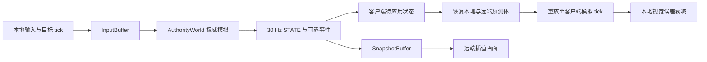

# 联机架构资料与源码审计

日期：2026-10-24。审计对象：本地 `siri_v0.5.0`，HEAD `0f6cf07`。

本文保留改造前的阅读与审计记录；后续已写入代码的变更见[联机重构说明](netcode_refactor.md)。

本阶段按用户要求集中查资料、阅读代码，不继续执行测试，不修改运行时代码。用户提出暂停前已经启动的回归已中止，其部分输出不作为本阶段验收。已有的 `netcode_architecture_research.md` 保留原样；历史验证记录只用于确定背景和未关闭问题，不作为本轮新增实测。

下文将“源码直接可见的差异”“差异可能产生的后果”和“需要后续验证的实现方案”分别描述。没有从静态阅读推算改善百分比，也没有把历史大幅校正逐条归因给本次发现。

后续补充的游戏公司报告和 GDC 讲义见[大型游戏联机技术扩展阅读](netcode_industry_reading.md)。其中进一步区分逐 tick 比较数据与完整恢复检查点，并细化最小依赖状态、对象生命周期和复制缓存的取舍。

## 1. 大型多人游戏采用的方法及适用范围

| 要解决的问题 | 一手资料 | 对本项目的适用判断 |
|---|---|---|
| 大量并发对局 | [AWS：Game server processes](https://docs.aws.amazon.com/wellarchitected/latest/games-industry-lens/game-server-processes.html)将游戏实例、对局进程和玩家会话分开 | 本项目 `RoomSession → AuthorityWorld` 可以保留；多进程部署解决总体并发，客户端重放仍需单独优化 |
| 持续世界 | [AWS：Hosting Persistent World Games](https://aws.amazon.com/blogs/gametech/hosting-persistent-world-games-on-amazon-gamelift/)区分短时会话和持续运行、保存状态的世界 | 目前是房间对战。世界编排与持久化不是这次校正缺陷的直接修复手段 |
| 大量复制实体 | [Epic：Replication Graph](https://dev.epicgames.com/documentation/en-us/unreal-engine/replication-graph-in-unreal-engine)通过持久、可共享的相关性列表减少逐对象逐连接计算 | 将来增加人数时可以引入空间相关性、休眠和频率分级；参与硬阻挡的实体需要额外满足预测依赖约束 |
| 人物即时控制 | [Epic：Character Movement 网络流程](https://dev.epicgames.com/documentation/en-us/unreal-engine/understanding-networked-movement-in-the-character-movement-component-for-unreal-engine)保存移动记录，由服务器确认、纠正，再重放后续移动 | 适合本地角色预测，但本项目还要处理其他角色硬阻挡、击退和可破坏地形 |
| 强物理交互 | [Psyonix：It IS Rocket Science!](https://media.gdcvault.com/gdc2018/presentations/Cone_Jared_It_Is_Rocket.pdf)，PDF 第 133–177 页 | 要比较对应历史帧，并让相互作用的对象共同恢复和追赶；高延迟会增加重放量，未知对手操作仍会产生误判 |
| 避免重复预测 | [Valve：Source SDK prediction.cpp](https://github.com/ValveSoftware/source-sdk-2013/blob/master/src/game/client/prediction.cpp)，`ComputeFirstCommandToExecute` | 没有新更新或确认没有字段误差时复用已有结果，有误差时重新预测。应用到本项目还需要校验远端输入、地形与战斗事件 |
| 防止跨时间线碰撞 | [Unity：Prediction edge cases](https://docs.unity.cn/Packages/com.unity.netcode%401.3/manual/prediction-details.html)说明部分对象回滚、其他对象留在新 tick 会导致交互错误 | 当前硬阻挡预测组应具有一致的模拟时间和状态恢复边界；空间裁剪应在依赖正确之后引入 |
| 区分延迟来源 | [Riot：Gameplay Consistency Update 2](https://playvalorant.com/en-us/news/game-updates/valorant-gameplay-consistency-update-2/)分别讨论网络 RTT 和缓冲处理延迟 | 需要区分网络传输、收发排队、主线程派发、模拟和表现。固定传播时延并不能证明没有本机调度延迟 |
| CPU 预算 | [Riot：VALORANT 128-tick servers](https://www.riotgames.com/en/news/valorants-128-tick-servers)按子系统分解成本 | 重点看预测世界每秒被推进多少次，以及每次的角色数、碰撞、弹丸与恢复成本 |
| 模拟与视觉分离 | [Gaffer：State Synchronization](https://gafferongames.com/post/state_synchronization/)将物理状态恢复与渲染误差衰减分开 | 保留物理权威恢复和视觉平滑的分工。平滑参数不能消除模拟分支差异 |
| 预测范围选择 | [SnapNet：Snapshot Interpolation](https://snapnet.dev/blog/netcode-architectures-part-3-snapshot-interpolation/)解释预测对象与插值对象的不同时间线 | 远端画面可以插值，远端阻挡预测体需要按模拟 tick 推进；二者职责应明确分开 |
| 引擎边界 | [Godot：Physics introduction](https://docs.godotengine.org/en/stable/tutorials/physics/physics_introduction.html)明确物理不保证确定性；[CPU optimization](https://docs.godotengine.org/en/stable/tutorials/performance/cpu_optimization.html)要求区分自身成本、调用成本和等待 | 共用 60 Hz 不足以保证同输入同结果；也不能只凭脚本结构断言哪一个原生查询占时最多 |

由这些资料推导的方向是：保留专用服务器权威；完善参与交互的预测状态与统一步进；在一致性条件成立后复用历史结果。当前八人规模可以先保留完整角色预测组，把兴趣管理作为后续扩容工作。

## 2. 当前源码实际执行的流程

入口与主要模块：

- [NetBus](../../core/net/net_bus.gd)：物理帧开始轮询 GNS，解码并派发输入、STATE 和事件。
- [RoomSession](../../server/room_session.gd)：维护席位、基线握手，合批转发远端输入提示。
- [AuthorityWorld](../../server/authority_world.gd)：角色按 role 排序步进，推进 Beta 和账户，再模拟弹丸、处理规则、提交地形碰撞，发送状态。
- [PvpMatchClient](../../scenes/pvp_match_client.gd)：接收状态后暂存，在物理帧统一应用；重放后采样本地输入并推进预测。
- [PredictionRollback](../../core/net/prediction_rollback.gd)：保存待确认输入，恢复本地状态后逐 tick 推进本地角色和远端预测体。
- [PlayerReplica](../../scenes/player/player_replica.gd)：同时持有远端视觉节点和用于硬阻挡的隐藏 Player。
- [CombatPrediction](../../core/net/combat_prediction.gd)：逻辑弹丸、光束、爆炸和命中确认，以及临时地形的恢复/预测通知。



已经实现且应保留的设计：移动/动作分开 ACK、epoch、持续输入冗余、STATE 增量基线、帧内合并待应用状态、连续预测时钟、逻辑弹丸与可见弹丸分离、按受击者确认命中、预测地形撤销，以及本地视觉平滑。

## 3. 会影响同输入一致性的源码差异

### 3.1 远端硬阻挡预测没有执行完整的角色步进

源码位置：`prediction_rollback.gd::_step`、`player_replica.gd::apply_snapshot/anchor_collision`、`actor_step.gd::step/simulate`、`weapon_base.gd::tick/fire/get_movement_multiplier`。

直接可见的事实：

- 权威角色和本地预测角色调用 `ActorStep.step`；它消费动作、切枪、推进武器，然后计算本 tick 移动倍率与角色运动。
- 远端预测体只将输入写入 `step_input`，然后调用 `ActorStep.simulate_motion`。
- 远端 `move_mult` 取自最近一次快照，在整个追赶区间内保持不变。远端预测体没有恢复背包、当前武器、冷却、预瞄和射击序号，也不执行开火后坐力。
- `_forecast` 起初为空手，视觉武器是另一套节点；收到输入提示不会使隐藏预测体获得完整的武器模拟状态。

推论：已知的切枪、开火、预瞄松键或冷却结束，仍可能使服务器与远端阻挡体走出不同轨迹。本地角色撞到不同位置的远端阻挡体后，会出现二次分歧。这条路径不要求网络抖动，不能全部归类成“对手未来输入未知”。

这里缺少的无敌时间和氧气内部计时也说明恢复不是完整状态，但当前 PvP 取消常规无敌帧阻挡，溺水伤害也受 PvP 分支限制；不能把这两个字段直接宣称为大幅校正的已证实原因。

### 3.2 榴弹近身引信采用两套目标筛选规则

源码位置：`bullet_base.gd::simulate_tick/_check_player_contact/player_contact`、`combat_prediction.gd::step`。

权威榴弹的 `simulate_tick` 进入 `_check_player_contact`，遍历场景分组并检查距离和友军；该函数没有排除倒地和回溯中的角色。预测榴弹设置 `prediction_only`，跳过这个分支，由 `CombatPrediction.step` 调用 `player_contact`，后者明确排除倒地和回溯中的角色。

因此，在角色状态和空间位置相同的条件下，尸体或回溯角色可以只在权威分支触发短引信。爆炸 tick、受击和后续运动可能随之不同。筛选差异由源码确认，具体误差幅度本阶段没有测量。

建议将目标资格判断和引信接触阶段提取为双方共用的函数，并明确尸体/回溯角色是否触发引信的游戏规则。

### 3.3 光束的权威命中与预测命中使用不同时间的目标包围盒

源码位置：`laser_weapon_base.gd::_body_rect`、`authority_world.gd::target_rect_at`、`combat_prediction.gd::step_beams`。

服务器依据射手 `view_tick` 查询最多 12 tick 的历史包围盒；预测光束用传入角色当前的 `CollisionAabb.world_rect`。光束路径相同也不意味着命中对象相同。

这是延迟补偿语义与当前物理预测之间的缺口。不能直接删除历史命中查询来换取表面一致性。需要区分“用于判定命中的历史查询世界”和“承受该命中结果的当前模拟世界”，再决定客户端哪些命中可以提前改变物理状态，哪些依赖权威结果。

### 3.4 Beta 账户缺少未来区间的战斗和破坏入账

源码位置：`authority_world.gd::damage/_record_down/_on_sub_destroyed`、`time_economy.gd`、`combat_prediction.gd::_apply_hit`、`pvp_match_client.gd::_on_time_state/_predict_blast_terrain`。

权威世界会为伤害、击杀和子格破坏入账。客户端从 STATE 恢复账户，预测区间内推进加速消耗和自然回复；战斗预测没有执行对应入账，预测地形伤害也没有携带射手账户归因。

当余额接近零时，这种差异可能改变后续 `can_spend()` 和加速倍率；即使命中已经被客户端确认，在下一份覆盖该收益的 STATE 到达前，旧状态重放仍缺少该交易。

修复需要把账户交易纳入有 tick、阶段、归属和唯一标识的模拟事件，或共用相同的战斗收益计算。仅把账户恢复到最新值，不能代替区间内的正确交易顺序。

### 3.5 并列最近的弹丸命中依赖候选数组顺序

源码位置：`bullet_base.gd::player_contact`、`authority_world.gd::_adjudicate_bullets`、`prediction_rollback.gd::_step`。

`player_contact` 只在新候选的距离严格更小时替换受击者。权威世界传入 `players.values()`；预测列表以本地角色开头，再追加按 role 排序的远端角色。因此，多个目标在弹道投影距离相同且均进入命中半径时，受击者可能不同。

应为相等距离规定共同的稳定决胜规则，或统一候选顺序。这是源码可见的顺序依赖；本阶段没有统计其实际触发频率。

## 4. 恢复边界与消息时间线仍需补齐

### 4.1 状态比较必须发生在整组对象恢复之前

`PvpMatchClient._apply_authority` 会先恢复全部远端预测体和账户，之后才调用本地 `reconcile`。因此，在 `reconcile` 内增加一个“本地状态相同则 return”的判断，会留下本地在预测终点、远端在旧快照 tick 的混合世界。

历史复用的决策应上移到共同恢复入口；或者必须同时恢复缓存中的整组当前状态、账户和弹丸检查点。缓存的有效性判断不能只属于本地玩家。

### 4.2 弹丸的原始出生信息与可变检查点混在一起

`CombatPrediction.seed_projectile` 记录 `tick/state`，`prepare` 又推进并覆盖这两个字段。非权威弹丸可能保留到后续快照；`shot_actions` 遇到同 ID 已存在时不会按新预测的出生状态重建。

目前缺少独立、不可变的出生 tick 和对应输入 epoch/seq，用于证明该弹丸是否已被权威状态覆盖、拒绝，或仍属于待执行输入。应把 `spawn_tick`、`checkpoint_tick`、`sim_tick` 分开，定义预测匹配、撤销和权威替换规则。

这部分属于生命周期审计项：源码证明现有信息与恢复路径有歧义，但尚不能据此宣布已复现某场幽灵弹丸或某个误差。

### 4.3 输入提示的增量语义与传输替换语义不完全相容

`RoomSession` 只收集发生变化的角色提示，发出后清空。GNS 扩展对 INPUT lane 使用单个 `latest[INPUT]`，发送受阻时，新报文会覆盖旧报文。

如果待发报文 A 含角色 2 的变化，后来的报文 B 只含角色 3，覆盖后角色 2 的变化不会由 B 自动补上。下一份 STATE 可以修复部分持续状态，但它不能完整代替每条历史动作边沿。

这是应用发送队列的覆盖机制，不等价于已经证明发生了链路丢包。可选修复为可合并的逐角色待发状态、携带有界冗余的输入历史，或有明确恢复规则的事件通道；不能直接把所有输入都改成无限可靠排队。

另据 [GNS v1.6.1 的 lane 契约](https://github.com/ValveSoftware/GameNetworkingSockets/blob/v1.6.1/include/steam/isteamnetworkingsockets.h)，只有同 lane 的可靠消息保证顺序。STATE 和 EVENT 分 lane 后，仍需在应用层处理出生、终止、地形和状态之间的覆盖关系。

### 4.4 当前地形不等于任意历史 tick 的地形

客户端已有临时爆炸地形的保存与撤销，且按 `map_revision` 等待可用 STATE。这些机制应保留。

但是弹丸 `prepare` 和 `_plan` 会在当前场景碰撞体上推进历史或未来弹道。更早 tick 的弹丸若需要跨过已经改变的地形区间，只有最新 HP 和一个地图版本号不足以恢复每个 tick 的查询环境。应将地形提交阶段和可回退的子格变化日志纳入预测历史。

## 5. 重放性能的结构性开销

### 5.1 每份 STATE 都从权威 tick 重算到预测终点

`PredictionRollback.history` 保存的是输入记录，不是逐 tick 的完整预测状态。`reconcile` 每次都会恢复本地状态、重置输入队列、准备战斗并重放；不存在对应历史状态一致时复用预测后缀的路径。

按当前 30 Hz STATE、60 Hz 模拟、8 名角色计算，若每次重放 32 tick：

```
仅重放角色步数 = 30 × 32 × 8 = 7680 次/秒
正常推进角色步数 = 60 × 8 = 480 次/秒
总角色步数约为正常推进的 17 倍
```

这是调用结构的算术估计，不是新的计时结果；未计入弹丸预报、碰撞重建、编解码和渲染。

### 5.2 一份状态处理内部还有重复的全量工作

直接可见的工作包括：

- `_step` 每 tick 重建角色列表，远端预测的准备和推进分布在多次循环中。
- `step_beams` 每角色每 tick 遍历并排序 `_attack_ids(beams)`；该函数还合并命中历史中属于其他阶段的攻击 ID。
- `InputBuffer.take` 每 tick 取得键数组、排序动作；远端 `receive_input` 使用嵌套 `any` 扫描历史提示。
- `_plan` 创建真实弹丸节点，同步模拟到结束后释放；这一段也会在消息派发期间发生。
- 临时地形在每次重放前撤销，重放经过爆炸时再次伤害并提交碰撞。
- `NetCodec` 在每连接编码时比较完整世界，并保存深拷贝；解码、快照保存和渲染采样也有深拷贝。

这些都是优化候选，不能仅凭阅读给它们排序耗时占比。首先减少需要重算的区间，再消除区间内重复排序、分配和查询，最后评估热点是否值得迁移到原生代码。

## 6. 建议的重构顺序

### 第一步：明确共同模拟状态与阶段

建立角色预测状态投影：包括运动、碰撞姿态、输入冻结/控制阶段，以及驱动运动的武器、射击和账户状态。它不需要包含 HUD、音效、动画和计分显示。

让本地角色、远端阻挡预测体与服务器调用同一个角色模拟入口。当前 `simulate_motion + 固定 move_mult` 应由可恢复的运动驱动状态替代；只替换函数名而不补武器和输入状态是不完整的。

为世界 tick 写出共同的阶段契约，再将角色、光束、Beta、账户、弹丸、爆炸、规则和地形提交的顺序显式化。首先保持现有权威规则，逐项消除预测分支差异，避免重构时无意改变游戏规则。

### 第二步：建立完整但有界的预测历史

建议新增世界级环形历史，与上行输入重发队列分开。每个完整 tick 至少保存：

- 预测组角色状态、角色顺序、控制 epoch、碰撞层/掩码与冻结状态。
- 各角色输入队列的必要消费状态、动作 ACK 和有效输入调度。
- 账户状态和已经应用的交易。
- 弹丸检查点、出生归因、引信和终止状态。
- 已应用战斗事件的位置，以及地形子格变化日志的位置。

角色和弹丸状态适合紧凑数据；地形适合可撤销的变化日志和分块检查点，避免每 tick 深拷贝整张地图。

### 第三步：按依赖验证历史并复用

收到权威 tick T 时，在修改当前预测世界之前比较 T 的历史。只有以下条件均满足，才可保留已有预测后缀：

1. 所有依赖角色的必要状态一致，分支标志和控制阶段一致。
2. 输入、动作的实际可用 tick 与确认语义没有变化。
3. 战斗、弹丸、账户和地形事件没有改变该区间。
4. 碰撞环境、参与角色及其相关性版本没有改变。

字段容差需要逐项定义；会影响跳跃、开火、死亡、加速和碰撞分支的差异不能被位置容差掩盖。发生变化时记录最早失效 tick，从有效检查点重放整组依赖对象；历史不足则使用已有的权威恢复路径。

`_pending_replay` 目前只记录原因字符串。可以增加最早失效 tick，并将同帧输入、事件、地形更新合并为一次恢复/重放。当前已有的状态合并逻辑应继续保留。

### 第四步：降低必需重放的单 tick 成本

角色列表和稳定顺序按成员变化更新；攻击按阶段、tick 和射手建立索引；输入历史使用有界有序结构；碰撞矩形按状态变化更新。

将模拟弹丸数据与可见节点的生命周期进一步分开，避免预报一次就创建和释放一套场景节点。原生化应针对之后确认的热点，保持双端共用同一实现。

八人阶段可先保持全部角色参与硬阻挡预测。以后按空间缩小预测范围时，需包括重放窗口内可到达的对象、子弹、爆炸和角色间的依赖传播，并定义进入预测组的完整基线。

### 第五步：再处理带宽、版本和扩容

补充状态字段或修改事件语义时，同步更新二进制编解码和协议兼容检查。当前 HELLO 只携带名称/色相，不能让新旧协议静默混用。

控制事件与大块基线可以再评估 lane、优先级和共享带宽预算，但通道优先级不能替代应用层的 tick/阶段覆盖规则。扩大人数后再引入复制相关性、休眠和分级频率。

## 7. 后续验证边界（当前未执行）

已有测试和历史实战不需要为“阅读资料”重跑。实现改变以后，验证应针对改变的契约：已知远端开火/切枪后与本地硬阻挡、尸体和回溯角色的引信资格、光束历史查询、余额临界时的战斗入账、并列命中选择，以及输入提示在本地发送队列中的替换。

历史缓存还需验证新输入/命中/地形会使正确的后缀失效，重复消息不会重复执行收益或伤害。性能对比必须在结果等价、相同窗口和相同参与对象的前提下进行。

本阶段没有实施这些验证，也没有宣称任何运行时缺陷已修复。原始大幅校正现场中涉及未知远端操作的部分，仍需要与上述可见实现差异分开处理。
