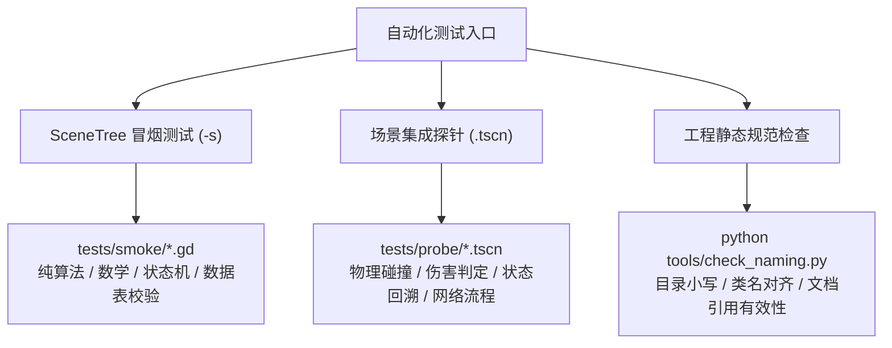

# 测试体系与验证规范

本文档介绍项目的自动化测试分层架构、执行方式、判定标准及测试编写准则。

---

## 一、 测试分层架构

项目基于 Godot 引擎原生能力提供纯逻辑、场景集成及多进程网络测试，不依赖第三方单测插件：



### 1. SceneTree 纯逻辑冒烟测试 (`tests/smoke/*.gd`)
- **执行方式**：`godot --headless --path . -s res://tests/smoke/<name>.gd`。
- **运行环境**：测试脚本继承自 `SceneTree`。**注意：脚本编译阶段发生在 Autoload 初始化之前**，被测代码若依赖全局单例需显式传入或使用静态工具类。
- **覆盖范围**：环形空间几何计算、计分公式（`score_rules.gd`）、武器背包管理（`WeaponInventory`）、时间颗粒状态机（`GrainAccount`）及数据配置表完整性校验。
- **通过判据**：控制台输出包含 `SMOKE OK` 且进程退出码为 0。

### 2. 场景集成探针测试 (`tests/probe/*.tscn`)
- **执行方式**：`godot --headless --path . --quit-after 3600 res://tests/probe/<name>.tscn`。
- **运行环境**：完整加载场景树与 Autoload 单例。`--quit-after 3600` 提供最大帧数超时保护（约 60 秒），防止因逻辑死锁导致测试挂起。测试完成后通常主动调用 `get_tree().quit(0)` 退出。
- **覆盖范围**：物理碰撞与穿透检测、伤害结算、客户端预测与回滚、双端网络同步与断线重连。
- **通过判据**：控制台输出包含 `ALL-OK`。

### 3. 测试辅助基础库 (`tests/lib/`)
- **`ScanUtil` (`tests/lib/scan_util.gd`)**：源码文本静态分析工具，支持代码行过滤、注释剥离与函数体提取。
- **`ProbeBase` (`tests/lib/probe_base.gd`)**：场景探针基类节点，提供标准断言方法、错误统计与测试结果汇总输出。

---

## 二、 测试编写规范与执行准则

### 1. 测试成功的多维判定
由于 Godot 在部分脚本运行时异常退出时仍可能返回状态码 0，因此自动化测试判定必须同时满足以下条件：
1. 控制台输出明确的成功文本标记（如 `SMOKE OK` 或 `ALL-OK`）；
2. 进程退出码为 0；
3. 输出日志中无 `SCRIPT ERROR`、`Parse Error` 或 `Failed to load script` 报错；
4. 探针内需包含断言计数校验，防止函数因意外提前返回而跳过后续断言。

### 2. 真实流程驱动原则
编写探针测试时，应尽可能通过真实的按键输入、物理碰撞或网络数据包驱动完整业务流程，避免直接手动修改下游属性而产生虚假的测试通过。

### 3. 避免端口占用与残留子进程
网络测试必须使用动态分配的空闲端口。测试脚本仅清理自身启动的子进程，禁止根据进程名全局强杀系统其他进程。客户端通过 NetSession 持有本地服务端、EasyTier 核心及 CLI；Windows 使用 Job，macOS 使用生命期管道与进程组。

---

## 三、 常用核心测试用例

| 测试领域 | 关键测试脚本 | 核心测试点 |
|---|---|---|
| **敌人系统** | `tests/smoke/enemy_logic_smoke.gd` | 敌人属性配置、武器注册表校验、AABB 碰撞盒计算。 |
| **武器背包** | `tests/smoke/weapon_inventory_smoke.gd` | 背包 8 格容量与 4 把数量限制、换弹逻辑与唯一实例 ID 追踪。 |
| **对战计分** | `tests/smoke/score_rules_smoke.gd` | 击杀、助攻、自伤与友伤惩罚分计算。 |
| **时间机制** | `tests/smoke/grain_account_smoke.gd` | 颗粒消耗、透支锁定与自动回复。 |
| **断线重连** | `tests/smoke/grace_window_smoke.gd` | 60 秒宽限期进入与超时处置。 |
| **联机大厅** | `tests/smoke/pvp_room_smoke.sh` | 房间创建、大厅列表刷新与加入流程全链路。 |
| **工程规范** | `python tools/check_naming.py` | 目录全小写、类名与文件名映射、文档引用路径有效性。 |

---

## 四、 网络专项测试与自动化回归

网络测试套件主要命令行入口：

```powershell
python tools/run_regression.py --godot $env:GODOT --scenes --kind unit --jobs 2
python tools/run_regression.py --godot $env:GODOT --scenes --kind visual
python tools/run_regression.py --godot $env:GODOT --scenes --kind network
python tests/network/run_matches.py --godot $env:GODOT --count 2 --drop
python tests/network/run_matches.py --godot $env:GODOT --count 6 --rtt 80 --jitter 15 --loss 0.05 --drop
python tests/network/run_matches.py --godot $env:GODOT --count 8 --rtt 150 --jitter 25 --loss 0.05 --drop
python tests/network/run_matches.py --godot $env:GODOT --count 8 --rtt 150 --jitter 25 --loss 0.05 --drop --stall
python tests/network/run_easytier.py --godot $env:GODOT
python tests/network/run_process_lifecycle.py --godot $env:GODOT
python tests/network/run_movement.py --godot $env:GODOT
python tests/network/run_benchmark.py --godot $env:GODOT --count 8
python tests/network/run_matches.py --godot $env:GODOT --count 2 --server '.test_logs/windows_export/Cyancular Ruins Server.exe'
```

- **多进程端到端对战**：真实运行 `RoomSession`、`AuthorityWorld` 与 `PvpMatchClient`，覆盖基线同步、实体列表管理、回合流转、时间回溯机制、重连 Token 认证及结算面板展示。测试代理按照固定随机数种子模拟双向 RTT 延迟、抖动与丢包。
- **高负载断流压力测试 (`--stall`)**：在真实对战中注入双向 750ms 积压后的突发释放以及 250ms 完全断流，验证输入队列不超过未来调度窗口限制、超时按键复位、预测回滚正确性及断流恢复后的最终收敛。
- **进程生命周期回归 (`run_process_lifecycle.py`)**：覆盖客户端正常退出、窗口关闭、会话重建、场景切换及强制终止等各种场景，通过 Windows 进程句柄校验作业对象内所有子进程均能被安全回收。
- **macOS 产物与生命周期 (`run_macos.py`)**：接收 `--godot` 和 `--archive`，验证通用包的两种架构、签名及可执行权限；执行导出启动、六种退出场景、网络探针、包内服务端对局及 EasyTier 直连/中继。CI 在 Apple Silicon 和 Intel 上分别测试同一归档。
- **实际地图启动分析 (`startup_probe.tscn`)**：记录原生 CPU 架构、Godot 版本、地图尺寸、内存和场景创建、基线复位及首帧更新耗时，同时检查首帧更新是否替换碰撞节点。使用 `--headless --path . res://tests/network/startup_probe.tscn` 运行；追加 `--debug --ignore-error-breaks --profiling` 获取函数耗时与调用次数。macOS CI 分别保存普通计时和分析器日志。

### 分档波动网络与断供计量

[链路配置](../../tests/network/link_profiles.json) 定义六档传播 RTT 与丢包目标。两个方向各注入一半 RTT，并使用独立的随机序列；延迟、丢包目标按 5–11 秒周期波动。丢包具有平均连续三包的坏状态，结果另外记录实际丢包数。游戏 ping 包含进程轮询、排队和处理时间。

| 档位 | 波动传播 RTT | 波动丢包目标 |
|---|---:|---:|
| ≤0.1% / ≤50 ms | 10–50 ms | 0.02%–0.1% |
| ≤0.5% / ≤100 ms | 40–100 ms | 0.1%–0.5% |
| ≤1% / ≤200 ms | 80–200 ms | 0.2%–1% |
| ≤2% / ≤300 ms | 120–300 ms | 0.5%–2% |
| ≤5% / ≤500 ms | 200–500 ms | 1%–5% |
| ≥5% / ≥500 ms | 500–1000 ms | 5%–15% |

```powershell
python tests/network/test_network_link.py
python tests/network/test_network_metrics.py
python tests/network/run_matrix.py --godot $env:GODOT --counts 2 6 8 --seeds 1000 --drop
python tests/network/run_matches.py --godot $env:GODOT --count 2 --profile 50ms --network-seconds 12 --settle-seconds 10 --no-trace --drop
python tests/network/run_matrix.py --godot $env:GODOT --counts 2 --profiles 50ms over500ms --bandwidths 64 128 256 --drop --output .test_logs/network/bandwidth
```

矩阵仅使用原生 ENet。网络专用计量使用固定游戏种子、[不可破坏场地](../../tests/network/arena.cyrm)、步枪和逐 tick 恢复生命值的机器人，保留实际角色模拟与客户端预测。2、6、8 人共用大乱斗规则进行该控制负载；普通功能对局仍按人数使用对应模式。

基线、Beta、换回合及 token 重连作为无注入条件的预热；随后施加网络条件，适应 10 秒，计量 12 秒。窗口结束后解除注入，验证停止输入后的收敛和退出。`--network-seconds`、`--settle-seconds` 与 `--timeout` 分别控制计量、适应和整场墙钟上限。`--no-trace` 关闭性能回放记录。

连续两个渲染观测中，远端播放 tick 相同，且均停在外推上限，才累计两次观测间的单调墙钟时间。分母是同一窗口的有效观测时长。任一客户端窗口出现客户端或服务端帧间隔超过 50 ms、基线变化、断线、计量不完整或场次错误，整段排除并保留原因；无有效样本返回空值，不能作为零卡顿。网络突发同时引起处理长帧的窗口也属于无法归因，本指标不代表全部视觉卡顿。

服务端单列输入延续预算耗尽的 tick 比例，仅在整场客户端窗口均有效时报告。STATE 持续到达时仍可能发生上行输入断供，两项指标共同评价时效。窗口内另记 STATE 到达间隔、ENet ping 及发送流量。`--fixed-throttle` 是将双方 ENet throttle 固定为 32 的测试对照；默认使用正式代码的节流参数。

`--bandwidth-kbps` 指每位客户端每方向的带宽上限，实际在其 50%–100% 间波动。FIFO 排队预算为 100 ms，并允许两个最大数据包的串行时间；超过预算丢包。串行发送计入 IPv4/UDP 的 28 字节头。`packet_trace` 记录转发器入口的包时间与 UDP 长度，属于注入丢包和排队前的发送需求；汇总按计量窗口计算平均值及滑动 1 秒、100 ms 峰值。

矩阵顺序执行，逐场保存日志、链路条件、结果和汇总。流程完成状态、网络断供指标及排除原因分别记录。

实测性能与流量数据记录请参阅 [网络验证记录](network_validation.md)。已知偶发缺陷记录请参阅 [已知缺陷清单](registered-debt.md)。
