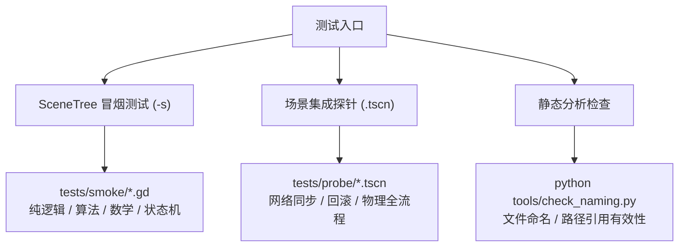

# 测试体系与验证规范

本文档说明项目的自动化测试分层结构、执行方式、判定标准及测试编写准则。

---

## 一、 测试分层架构

项目不依赖第三方测试插件，基于 Godot 引擎原生能力提供逻辑、场景及多进程网络测试：



### 1. SceneTree 纯逻辑冒烟测试 (`tests/smoke/*.gd`)
- **执行命令**：`godot --headless --path . -s res://tests/smoke/<name>.gd`。
- **环境特点**：脚本继承自 `SceneTree`。**注意：脚本编译发生在 Autoload 初始化前**，被测代码若依赖全局变量需显式传入或使用静态工具类。
- **覆盖范围**：环面数学计算、计分公式（`score_rules.gd`）、武器背包逻辑（`WeaponInventory`）、时间颗粒状态机（`GrainAccount`）及数据表解析。
- **通过判据**：控制台输出包含 `SMOKE OK` 且退出码为 0。

### 2. 场景集成探针 (`tests/probe/*.tscn`)
- **执行命令**：`godot --headless --path . --quit-after 3600 res://tests/probe/<name>.tscn`。
- **环境特点**：完整加载场景树与 Autoload 单例。`--quit-after 3600` 提供最大帧数超时保护（约 60 秒），防止死锁挂起。探针测试执行完毕后通常主动调用 `get_tree().quit(0)` 退出。
- **覆盖范围**：物理碰撞与穿透、伤害结算、客户端预测与回滚、双端网络同步与断线重连。
- **通过判据**：控制台输出包含 `ALL-OK`。

### 3. 测试辅助工具 (`tests/lib/`)
- **`ScanUtil` (`tests/lib/scan_util.gd`)**：代码文本分析工具，支持文件过滤、注释剥离与函数提取。
- **`ProbeBase` (`tests/lib/probe_base.gd`)**：探针基类节点，提供标准断言方法、错误汇总与总结打印。

---

## 二、 测试编写规范与准则

### 1. 输出文本标识优先于退出码
Godot 在某些脚本异常退出时可能返回状态码 0。因此：
- 自动化测试必须同时满足成功文本标记、退出码 0、无 SCRIPT ERROR，单凭其中一项不能判定通过。
- 探针内应包含断言执行计数校验，防止函数因意外提前返回而跳过后续断言。

### 2. 真实流程驱动
设计探针测试时，应尽可能由真实的输入、物理碰撞或三条网络数据流 驱动完整流程，避免直接手动修改下游属性造成虚假通过。

### 3. 规避端口占用与残留进程
网络集成测试使用动态端口，只关闭自己启动的进程。客户端所属的服务端、EasyTier 和 CLI 由 Windows Job 统一回收，不扫描系统进程或按可执行文件名结束进程。

---

## 三、 常用核心测试用例

| 模块 | 测试脚本 | 测试重点 |
|---|---|---|
| **敌人逻辑** | `tests/smoke/enemy_logic_smoke.gd` | 敌人属性、武器注册表校验、AABB 碰撞盒。 |
| **武器背包** | `tests/smoke/weapon_inventory_smoke.gd` | 背包 8 格容量与 4 把数量限制、换弹与实例 ID。 |
| **计分规则** | `tests/smoke/score_rules_smoke.gd` | 击杀、助攻、自伤与团队伤害惩罚分计算。 |
| **时间颗粒** | `tests/smoke/grain_account_smoke.gd` | 颗粒扣除、透支锁定与自动回复。 |
| **断线重连** | `tests/smoke/grace_window_smoke.gd` | 60 秒宽限期进入与超时处置。 |
| **联机大厅** | `tests/smoke/pvp_room_smoke.sh` | 房间创建、大厅列表与加入流程全链路。 |
| **工程规范** | `python tools/check_naming.py` | 目录与文件名小写、类名映射、文档路径有效性。 |

## 网络测试

共享步进测试执行返回的动作。网络测试入口：

```powershell
python tools/run_regression.py --godot $env:GODOT --scenes --kind unit --jobs 2
python tools/run_regression.py --godot $env:GODOT --scenes --kind visual
python tools/run_regression.py --godot $env:GODOT --scenes --kind network
python tests/network/run_matches.py --godot $env:GODOT --count 2 --drop
python tests/network/run_matches.py --godot $env:GODOT --count 6 --rtt 80 --jitter 15 --loss 0.05 --drop
python tests/network/run_matches.py --godot $env:GODOT --count 8 --rtt 150 --jitter 25 --loss 0.05 --drop
python tests/network/run_matches.py --godot $env:GODOT --count 8 --rtt 150 --jitter 25 --loss 0.05 --drop --stall
python tests/network/run_easytier.py --godot $env:GODOT
python tests/network/run_process_lifecycle.py --godot $env:GODOT
python tests/network/run_movement.py --godot $env:GODOT
python tests/network/run_benchmark.py --godot $env:GODOT --count 8
python tests/network/run_matches.py --godot $env:GODOT --count 2 --server '.test_logs/windows_export/Cyancular Ruins Server.exe'
```

多进程测试运行真实 RoomSession、AuthorityWorld 和 PvpMatchClient，覆盖基线、完整列表、回合、Beta、断线后的 token 认领、结果面板、同一房间返回与输入停止后的收敛。测试转发器按固定随机种子模拟双向 RTT、抖动和丢包，只清理自己启动的进程。性能基于相同真实消息轨迹的 ENet 回放，计量边界见 [联机说明](netplay.md)。

### 分档波动网络与断供计量

[链路配置](../../tests/network/link_profiles.json) 定义六档传播 RTT 与丢包目标。两个方向各注入一半 RTT，并使用独立的随机序列；延迟、丢包目标按 5–11 秒周期波动。丢包具有平均连续三包的坏状态，结果另外记录实际丢包数。游戏 ping 包含进程轮询、排队和处理时间。

| 档位 | 波动传播 RTT | 波动丢包目标 |
|---|---:|---:|
| ≤0.1% / ≤50 ms | 10–50 ms | 0.02%–0.1% |
| ≤0.5% / ≤100 ms | 40–100 ms | 0.1%–0.5% |
| ≤1% / ≤200 ms | 80–200 ms | 0.2%–1% |
| ≤2% / ≤300 ms | 120–300 ms | 0.5%–2% |
| ≤5% / ≤500 ms | 200–500 ms | 1%–5% |
| ≥5% / ≥500 ms | 500–1000 ms | 5%–15% |

```powershell
python tests/network/test_network_link.py
python tests/network/test_network_metrics.py
python tests/network/run_matrix.py --godot $env:GODOT --counts 2 6 8 --seeds 1000 --drop
python tests/network/run_matches.py --godot $env:GODOT --count 2 --profile 50ms --network-seconds 12 --settle-seconds 10 --no-trace --drop
python tests/network/run_matrix.py --godot $env:GODOT --counts 2 --profiles 50ms over500ms --bandwidths 64 128 256 --drop --output .test_logs/network/bandwidth
```

矩阵仅使用原生 ENet。网络专用计量使用固定游戏种子、[不可破坏场地](../../tests/network/arena.cyrm)、步枪和逐 tick 恢复生命值的机器人，保留实际角色模拟与客户端预测。2、6、8 人共用大乱斗规则进行该控制负载；普通功能对局仍按人数使用对应模式。

基线、Beta、换回合及 token 重连作为无注入条件的预热；随后施加网络条件，适应 10 秒，计量 12 秒。窗口结束后解除注入，验证停止输入后的收敛和退出。`--network-seconds`、`--settle-seconds` 与 `--timeout` 分别控制计量、适应和整场墙钟上限。`--no-trace` 关闭性能回放记录。

连续两个渲染观测中，远端播放 tick 相同，且均停在外推上限，才累计两次观测间的单调墙钟时间。分母是同一窗口的有效观测时长。任一客户端窗口出现客户端或服务端帧间隔超过 50 ms、基线变化、断线、计量不完整或场次错误，整段排除并保留原因；无有效样本返回空值，不能作为零卡顿。网络突发同时引起处理长帧的窗口也属于无法归因，本指标不代表全部视觉卡顿。

服务端单列输入延续预算耗尽的 tick 比例，仅在整场客户端窗口均有效时报告。STATE 持续到达时仍可能发生上行输入断供，两项指标共同评价时效。窗口内另记 STATE 到达间隔、ENet ping 及发送流量。`--fixed-throttle` 是将双方 ENet throttle 固定为 32 的测试对照；默认使用正式代码的节流参数。

`--bandwidth-kbps` 指每位客户端每方向的带宽上限，实际在其 50%–100% 间波动。FIFO 排队预算为 100 ms，并允许两个最大数据包的串行时间；超过预算丢包。串行发送计入 IPv4/UDP 的 28 字节头。`packet_trace` 记录转发器入口的包时间与 UDP 长度，属于注入丢包和排队前的发送需求；汇总按计量窗口计算平均值及滑动 1 秒、100 ms 峰值。

矩阵顺序执行，逐场保存日志、链路条件、结果和汇总。流程完成状态、网络断供指标及排除原因分别记录。

--stall 在对战中增加双向 750 ms 积压后的突发释放及 250 ms 完全断流；记录每个链路实际受扰动的包数，验证输入队列不超过未来调度窗口、超时后的中性按键、Beta 实际执行和最终收敛。input_playback_smoke 另外覆盖重复、乱序、序号空洞、100 次突发、缺包边沿、瞄准保留和播放时钟恢复。authority_probe 验证重放不重复生成弹丸、动画或界面通知，以及缩放角色的视觉校正不改变枪口。

protocol_probe 用真实权威世界验证二进制完整往返、预测计时器精度、房间/所有事件、武器配置、ACK 基线、丢包后增删、背包变化、缓存过期及换回合旧包。transport_probe 和官方隧道夹具传输真实二进制 INPUT、STATE 及 256 KiB 可靠基线，并重新创建压缩连接。

movement_probe 使用真实 ENet、客户端、角色步进和权威快照验证恢复/重放只在物理帧执行。持续相同输入隔离网络迟到产生的合理校正，run_movement 分别设置 30/144/240 FPS 上限，覆盖预测时钟 0.96/1.02 倍调速；断言没有渲染帧回摆或匀速移动中的停顿，并记录实际平均帧率。真实对战夹具另外检查镜头跟随本地 Visuals。

run_process_lifecycle 使用真实 Godot、服务端和官方 EasyTier，覆盖正常 quit、窗口关闭、会话重建、场景切换、强制终止和启动期间终止。通过 Windows 进程句柄验证全部所属进程退出及独立 EasyTier 存活，另测试 Unicode、空参数、引号、反斜杠、大输出和非零退出码。导出程序进行独立目录启动与实际服务端对局验证，见 [进程生命周期验证](process_lifecycle_validation.md)。

run_benchmark 使用真实对战记录回放二进制差量；--trace 指定记录。回放固定三个快照间隔（100 ms）的 ACK 基线年龄，生产使用真实解码 ACK。基线和对战分别报告 ENet 字节、包数、CPU 与编解码/发包耗时，记录文件作为测试输入。

验证结果见 [联机验证记录](network_validation.md)。精英掉落探针退出故障按失败计入，详见 [已知缺陷](registered-debt.md)。